# Settlement Reconciliation — Produtos de Dados

Solução para o case técnico de Engenharia de Dados (fintech de liquidações). Transforma
os dados de reconciliação — hoje presos no banco transacional — em **produtos de dados
consumíveis** por Operações, CFO e Compliance, com um pipeline **medallion** sobre
**DuckDB + dbt**, orquestrado por **Airflow** e servido como Parquet + BI.

> 📄 Enunciado original do desafio: [`docs/CHALLENGE.md`](docs/CHALLENGE.md)

---

## ⚡ Início rápido

Pré-requisitos: Docker + Docker Compose.

```bash
docker compose up -d --build          # sobe o container (DuckDB + dbt)
make run                              # ingest → dbt build (Silver/Gold + testes) → publish
make test                             # suíte pytest (corretude + idempotência + publish)

# consumir os produtos publicados (Parquet, sem tocar no warehouse):
docker compose exec pipeline duckdb -c \
  "select * from read_parquet('gold/mart_ops_health/**/*.parquet', hive_partitioning=true)"
```

Opcionais: `make bi-up` (Metabase → :3000) · `make airflow-up` (Airflow → :8080) ·
`make scale-test` (~1M linhas) · `make help` (todos os alvos).

---

## 🧭 Por onde começar (repo autoguiado)

Escolha pelo seu objetivo:

| Se você quer… | Comece por |
|---|---|
| **Revisar em 5 min** | [`SOLUTION.md`](SOLUTION.md) + [`docs/PR.md`](docs/PR.md) + o diagrama do pipeline abaixo |
| **Rodar o projeto** | a seção *Início rápido* acima |
| **Ver as respostas da entrega** (Como rodar, Premissas, Arquitetura, Extensibilidade, Limites, Produção, IA) | [`docs/PR.md`](docs/PR.md) |
| **Entender a modelagem** (Parte 1: perguntas por consumidor, tradeoffs) | [`docs/data-products.md`](docs/data-products.md) |
| **Entender a arquitetura** (Parte 3.1: diagramas) | [`docs/architecture.md`](docs/architecture.md) |
| **Saber como o negócio consome** | [`docs/consumption.md`](docs/consumption.md) |
| **Investigar um incidente** (Parte 3.2: runbook) | [`docs/troubleshooting.md`](docs/troubleshooting.md) |
| **Planejar escala** (Parte 3.3: ~5M/dia) | [`docs/scalability.md`](docs/scalability.md) |
| **Consultar o domínio** | [`docs/domain-glossary.md`](docs/domain-glossary.md) |

### Mapa da documentação

| Documento | O que cobre |
|---|---|
| [`SOLUTION.md`](SOLUTION.md) | Visão geral + índice: como as partes se encaixam e onde cada requisito é atendido |
| [`docs/PR.md`](docs/PR.md) | **Descrição do PR** — todas as seções de entrega, em PT-BR |
| [`docs/data-products.md`](docs/data-products.md) | Parte 1 — modelagem, o que cada mart responde (e o que não), o caveat do CSV sintético |
| [`docs/architecture.md`](docs/architecture.md) | Parte 3.1 — diagramas (pipeline, DAG, produção) em Mermaid + PNG |
| [`docs/consumption.md`](docs/consumption.md) | Camada de consumo — Parquet, Metabase, SQL, mapeamento por consumidor |
| [`docs/troubleshooting.md`](docs/troubleshooting.md) | Parte 3.2 — runbook de "segunda de manhã sem dados" |
| [`docs/scalability.md`](docs/scalability.md) | Parte 3.3 — onde o desenho quebra e o plano de evolução |
| [`docs/review-decisions.md`](docs/review-decisions.md) | Respostas às revisões (CodeRabbit + Codex): o que foi corrigido, adiado e **por quê** |
| [`docs/domain-glossary.md`](docs/domain-glossary.md) | Glossário do domínio de reconciliação |
| [`docs/CHALLENGE.md`](docs/CHALLENGE.md) | Enunciado original (preservado) |

O rastro completo de decisão (brainstorm → requisitos → design com ADRs) está versionado
em `.claude/sdd/features/`.

---

## 🗺️ Arquitetura (resumo)

```mermaid
flowchart LR
    classDef src fill:#e8eef7,stroke:#5b7aa8,color:#1a2c42;
    classDef bronze fill:#f4e6cf,stroke:#b08637,color:#3a2c10;
    classDef silver fill:#e6e9ec,stroke:#8a97a3,color:#26303a;
    classDef gold fill:#f7efc9,stroke:#c9a634,color:#3d3208;
    classDef pub fill:#dcefe4,stroke:#4f9d76,color:#123425;

    SRC["Fontes<br/>CDC parquet + PaySettler CSV"] --> BR["Bronze<br/>landing + linhagem"]
    BR --> SIL["Silver<br/>colapso CDC · repara · stg_settlements"]
    SIL --> INT["int_reconciliation<br/>janela 7d · tol. R$0,01"]
    INT --> GLD["Gold<br/>dims + fatos + marts"]
    GLD --> DQ{{"dbt test<br/>error=bloqueia · warn=alerta"}}
    DQ --> PUB["Publish<br/>Parquet + serving.duckdb"]
    PUB --> CON["Consumo<br/>Metabase · Parquet · SQL"]
    class SRC src;
    class BR bronze;
    class SIL silver;
    class INT,GLD gold;
    class PUB pub;
```



<sub>📎 Diagramas completos (com fallback PNG) em [`docs/architecture.md`](docs/architecture.md).</sub>

**Destaques do desenho:** recalcula a reconciliação a partir das fontes cruas · idempotência
por `delete+insert` na chave natural (rodar de novo não duplica) · qualidade com gate
`error`/`warn` · costura canônica `stg_settlements` para plugar novos processadores ·
produtos publicados em Parquet, desacoplados do warehouse single-writer.

---

## 📁 Estrutura do projeto

```text
src/pipeline/        Ingest (Python + DuckDB), CLI, publish, observabilidade
  ingest/            bronze.py, csv_parser.py
  publish.py         exporta Gold → Parquet + catálogo serving.duckdb
  cli.py             python -m pipeline {ingest,run,dbt-run,dbt-test,publish}
dbt/                 projeto dbt-duckdb
  models/staging/    Silver (colapso CDC + repair; stg_settlements = costura canônica)
  models/intermediate/ int_reconciliation.sql  ← o motor de reconciliação
  models/marts/      Gold: dims + fatos + marts (ops / finance / compliance)
  macros/ tests/     clean_amount + testes de DQ (error/warn)
airflow/dags/        DAG: ingest ▶ dbt run ▶ dbt test ▶ publish
sql/examples/        queries de exemplo por consumidor
tests/               pytest: reconciliação, idempotência, ingest, publish
docs/                documentação (ver mapa acima) + img/ (diagramas)
```

---

## 🔧 Comandos (Makefile)

| Comando | O que faz |
|---|---|
| `make run` | Pipeline completo para `REFERENCE_DATE` (default `2025-03-16`) |
| `make run REFERENCE_DATE=2025-03-13` | Processa outra data (acumula, sem sobrescrever) |
| `make test` | Suíte pytest dentro do container |
| `make publish` | Exporta só os produtos Gold para `gold/` |
| `make bi-up` / `make bi-down` | Metabase sobre os produtos (http://localhost:3000) |
| `make airflow-up` / `make airflow-down` | Airflow (http://localhost:8080) |
| `make scale-test` | Gera ~1M linhas e roda o pipeline contra elas |
| `make help` | Lista todos os alvos |

**Stack:** Python 3.12 · DuckDB · dbt-duckdb · Apache Airflow · Docker Compose.
