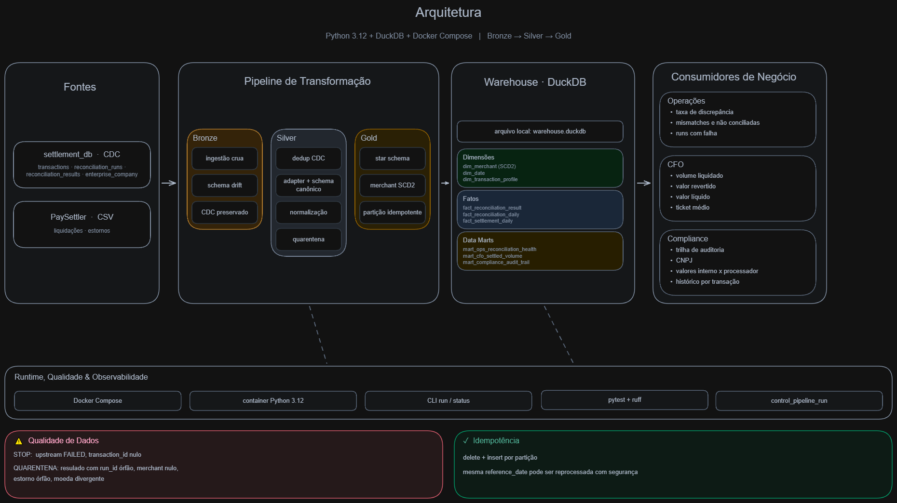
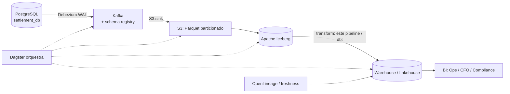

# Solução — Settlement Reconciliation Analytics

Pipeline analítico que transforma os dados do Settlement Reconciliation Service em produtos
de dados para Operações, CFO e Compliance. A stack é Python 3.12, DuckDB e Docker Compose, com
arquitetura medalhão (bronze → silver → gold) e adapters por fonte.

> Documento de design detalhado (decisões e tradeoffs): [`docs/design/decisoes-de-design.md`](docs/design/decisoes-de-design.md).

---

## Como rodar

### Local (Python)
```bash
python -m venv .venv && . .venv/Scripts/activate    # Windows; Linux: source .venv/bin/activate
pip install -e ".[dev]"

# processa uma data de referência (+ janela de 7 dias) e grava em warehouse.duckdb
python -m pipeline.cli run --reference-date 2025-03-16 --db warehouse.duckdb --data docs/sample-data

# inspeciona o histórico de execuções (observabilidade)
python -m pipeline.cli status --db warehouse.duckdb

# testes
pytest -v
```

### Docker
```bash
docker compose up -d --build
docker compose exec pipeline python -m pipeline.cli run --reference-date 2025-03-16
docker compose exec pipeline pytest -v
```
> O `docker compose up` sobe o container ocioso (`tail -f /dev/null`), seguindo o mesmo padrão do `Makefile` do desafio (`make up` + `make shell`/`make test`/`make run`); o pipeline é disparado via `exec` (acima), o que deixa o container como ambiente de execução reutilizável. Em hosts sem o plugin `compose`, use `docker-compose` (hífen) ou `make <alvo> COMPOSE=docker-compose`.

As queries de exemplo por consumidor estão em [`docs/queries/`](docs/queries/).

---

## Premissas e decisões

As decisões abaixo vieram da inspeção do fixture em `docs/sample-data`, não de suposições sobre o domínio.

| # | Ambiguidade | Decisão | Por quê |
|---|---|---|---|
| D1 | Refazer a reconciliação ou consumir o resultado pronto? | Consome `reconciliation_results`. | O serviço já reconcilia; nosso produto é analytics sobre o resultado. |
| D2 | Papel do CSV PaySettler, já que o resultado existe? | Feed canônico de liquidação: enriquece (`settled_at`, `REVERSED`), faz cross-check e é o ponto de extensão. | `reconciliation_results` não tem `settled_at` nem status de reversão. |
| D3 | Tratamento do CDC (`Op`/`_timestamp`)? | Última versão por chave e exclui `Op='D'`. | Os dados reais têm `U` (update) e `D` (delete) — embora o gerador do repo só emita `I`. |
| D4 | Schema drift (`payment_method` só no batch 2)? | `read_parquet(..., union_by_name=true)`. | Unifica por nome; ausente vira NULL. |
| D5 | Histórico de atributos do merchant (SCD)? | `dim_merchant` modelada como SCD Type 2 (`valid_from`/`valid_to`/`is_current` + join as-was); hoje guarda a versão corrente, pois a silver consome a última versão — ver Limites. | Compliance precisa de auditoria "as-was"; a estrutura deixa o histórico pronto pra ser retido. |
| D6 | Granularidade temporal | Batch diário por `reference_date` + janela deslizante de 7 dias. | Janela de reconciliação do domínio. |
| D7 | Tolerância de valor | `difference <= R$ 0,01`. | Glossário. |
| D8 | Run upstream `FAILED` (2025-03-22)? | Data não é processada; falha registrada na tabela de controle. | Não propagar resultado de reconciliação incompleta. |
| D9 | `settled_amount` (CSV) ≠ `processor_amount` (results) por transação no fixture | Surfaço ambos na trilha de auditoria, sem assumir igualdade. | São fontes independentes no fixture; em produção eu adicionaria um check de DQ exigindo que reconciliem. |
| D10 | "Volume por dia" (CFO) e "saúde por dia" (Ops) têm semânticas de data diferentes | Dois fatos diários: `fact_reconciliation_daily` (por `reference_date` da run, grão por transação) p/ Ops; `fact_settlement_daily` (por `settled_at`) p/ CFO | Evita contar a mesma liquidação em várias runs (fan-out cross-date) e a mistura de grãos. |
| D11 | Surrogate keys precisam sobreviver entre runs (fatos persistem, dims são reconstruídas) | Chaves determinísticas (`dense_rank` sobre a chave natural), não sequência resetada | Um fato escrito numa run continua apontando pro merchant certo após outra run reconstruir a dimensão. |
| D12 | Results com `run_id` órfão (=99, 5 linhas) e `merchant_id` nulo (16 linhas) | Quarentena (`quarantine_results` + contagem), não descarte silencioso nem bucket NULL | Trilha de auditoria reconcilia com os results mantidos; nada some sem registro. |

Algumas descobertas no fixture guiaram o desenho (provadas, ver `docs/design`): há CDC com `U`/`D`; o `id` não é único na união dos lotes, então o dedup precisa de um desempate determinístico via `rowid`; os valores vêm em formato BR (`R$ 47.401,20`); as 70 linhas de merchant se reduzem a 50 distintos (CDC); o CSV tem 510 linhas para 500 `transaction_id` distintos; e `reconciliation_results` tem 837 linhas em 793 pares (txn, run) — por isso o grão do fato de auditoria é o `result_id`.

---

## Visão geral da arquitetura



Os módulos em `pipeline/` são pequenos e com responsabilidade única: `cli` e `runner` cuidam da
execução; `config` e `adapters/` (base + paysettler) cuidam das fontes; `bronze`, `silver`
(dedup CDC + conformação) e `gold` (dims/fatos/marts) são as camadas de transformação; `quality`
roda os checks de qualidade; `control` é a observabilidade (watermark); e `db` cuida da conexão
e das transações.

### Modelo dimensional (gold) — 3 fatos + 3 dimensões + 3 marts
- `fact_reconciliation_result` — *transaction fact*, grão = 1 linha por `reconciliation_result` (degeneradas `result_id`, `transaction_id`, `reconciliation_run_id`). É a trilha de auditoria imutável e atende Compliance. Liga ao merchant por join as-was sobre `dim_merchant` (resolve para a versão corrente hoje — ver Limites).
- `fact_reconciliation_daily` — *periodic snapshot*, grão = `reference_date` × merchant × moeda, colapsado por (transação, run) com a pior severidade vencendo. Taxas de discrepância, atende Operações.
- `fact_settlement_daily` — *periodic snapshot*, grão = `settled_at` × merchant × moeda, vindo do feed de liquidação (1 linha/transação, sem fan-out). Volume liquidado/revertido/líquido e ticket médio, atende CFO.
- `dim_merchant` (estrutura SCD2 + chave determinística; guarda a versão corrente hoje — ver Limites), `dim_date` (role-playing: reference/settlement, padded) e `dim_transaction_profile` (junk: categoria, tolerância, status, flags).

### Perguntas que o modelo responde (exemplos rodados no fixture, `--full`)
Operações — taxa de discrepância por dia (9 dias): varia `12,9%–15,8%`; runs com falha/rejeição via `control_pipeline_run` (rejeitadas=22).
CFO — volume liquidado por dia de liquidação × moeda × CNAE (todo o feed cai em 2025-03-16); líquido e ticket médio (~R$ 24–27 mil por setor).
Compliance — trilha completa por transação (com CNPJ e `processor_reference`); contagem de `UNRECONCILED_*`; ranking de CNPJ por `MISMATCHED`. Reconcilia: trilha = results mantidos (816), nada some em silêncio.
*Deliberadamente NÃO responde:* receita/fees (sem dado), tempo real (é batch), relatório regulatório formatado.

---

## Qualidade, idempotência, observabilidade, testes

- **Qualidade (3 camadas):** a silver corrige sujeiras recuperáveis (vírgula decimal, `R$`, timezone, caixa do `merchant_id`). O pipeline para (circuit breaker) quando a run da data pedida não está `COMPLETED` ou há `transaction_id` nulo. O resto vai para quarentena com motivo e é contado: `REVERSED` órfão (`quarantine_settlement` = 1), result com `run_id` órfão ou `merchant_id` nulo (`quarantine_results` = 21) e moeda divergente entre interno e processador (`quarantine_settlement` = 0 no fixture, tudo BRL). A quarentena roda antes de derivar `silver_settlement_current`, então as tabelas analíticas nunca veem linha quarentenada.
- **Idempotência:** reprocessa a janela `[ref-7d, ref]` substituindo cada partição com `BEGIN; DELETE … WHERE reference_date; INSERT …; COMMIT;` (atômico **por partição**, no mesmo `.duckdb`). Re-rodar a mesma data → contagens idênticas (teste automatizado). Chaves surrogate determinísticas mantêm fatos antigos consistentes com dims reconstruídas.
- **Observabilidade:** `control_pipeline_run` (run_id, status, rows_read/written/**rejected**, timestamps) — 1ª fonte no troubleshooting. Atomicidade é por-partição (não run-wide); o status reflete o desfecho da execução.
- **Testes:** 45 testes pytest cobrindo dedup CDC (com delete), parser BR de valores, tolerância, quarentenas, grão e reconciliação dos fatos, ausência de fan-out no CFO, chaves determinísticas, idempotência, exit code não-zero em FAILED e o e2e da CLI.

---

## Extensibilidade — plugar um 2º processador

Todo adapter devolve o schema canônico de liquidação (`config.CANONICAL_SETTLEMENT_COLUMNS`).
Cada processador novo precisa de um adapter em `adapters/<novo>.py` (implementando
`SettlementAdapter.canonical_sql`) e de uma entrada em `config.SOURCES`. Silver e Gold operam
só sobre o canônico, então não mudam.

> Na prática, plugar um segundo processador toca cerca de 2 arquivos (o adapter novo + o bloco
> em `config.SOURCES`), mais os testes desse adapter. Nenhum módulo de transformação a jusante é
> tocado; os testes existentes seguem válidos.

---

## Limites deliberados do desenho

1. **Sem backfill de chegada tardia além da janela de 7 dias** — liquidação muito atrasada não reabre uma partição "fechada"; produção precisaria de replay sob demanda.
2. **Não é fonte de verdade da categorização** — consome `reconciliation_results`; erro do upstream se propaga. Produção desacoplaria com testes de contrato.
3. **DuckDB de processo único escritor** — sem múltiplos escritores nem serving concorrente de muitos usuários de BI no mesmo arquivo (ver Parte 3.3).
4. **Check de queda de volume não codado** — comparar direto com `runs.total_transactions` daria falso-positivo neste fixture (lá `total_transactions` conta linhas do CSV, não `results`); um check honesto exigiria baseline histórico (média móvel), que 1 dia de CSV de exemplo não permite validar. *(A divergência de moeda interno×processador, ao contrário, está implementada como quarentena.)*
5. **Atomicidade por-partição, não run-wide** — uma falha após uma partição já commitada deixa essa partição gravada (o re-run é seguro por ser idempotente), e o enriquecimento de liquidação na trilha de auditoria reflete a última liquidação da transação. No modo `--full`, os fatos são limpos antes do rebuild — há uma janela curta de tabela vazia se o processo morrer no meio (o re-run idempotente recompõe).
6. **Histórico de merchant não retido** — `dim_merchant` e o join são SCD2, mas a silver guarda só a última versão de cada merchant (1 versão por merchant hoje); auditoria "as-was" de verdade exigiria preservar as versões anteriores na silver.

---

## Parte 3 — Produção

### 3.1 Arquitetura de produção

O **core de transformação** (bronze/silver/gold em DuckDB) é o mesmo localmente e em produção
— trocando o armazenamento de um `.duckdb` por Iceberg + engine distribuída quando necessário.

### 3.2 Troubleshooting — "dashboards sem dados desde sexta"
Eu iria do sintoma à origem. Começo pela `control_pipeline_run`: a última run terminou `SUCCESS`? tem alguma `FAILED` ou `RUNNING` travada? Depois olho o histórico do orquestrador — a run de sexta chegou a rodar, falhou, ou rodou sobre input velho? Em seguida os logs por `run_id` para localizar o nó parado, e o frescor das fontes (o último parquet/arquivo chegou?). Só então eu olharia o CDC: o lag do slot do Debezium via `pg_replication_slots` (distância de LSN; `active_pid` nulo indica conector caído). O ponto é não assumir que o problema é o CDC antes de checar o orquestrador.

### 3.3 Escalabilidade (→ ~5M transações/dia, ≈1,8B/ano)
O gargalo não é volume: 1,8B linhas/ano cabem num nó (o DuckDB faz out-of-core e já rodou TPC-H em escala de TB). O que aperta primeiro é a concorrência (um processo escritor) e o serving multiusuário. O caminho é particionar por data, separar ingestão de serving, e migrar o armazenamento de um `.duckdb` único para Iceberg com engine distribuída (Spark/Trino) ou um DW (BigQuery/Snowflake/ClickHouse) quando a concorrência exigir — mantendo o DuckDB para dev/embedded.

---

## O que faria diferente em produção
Pra caber no escopo do desafio, simplifiquei de propósito: DuckDB num único arquivo (em vez de um data warehouse distribuído), batch diário (sem streaming), SQL inline no `gold.py` (em vez de dbt) e execução por CLI (sem orquestrador). Em produção eu moveria as transformações para dbt, ganhando testes, documentação e linhagem nativos. Persistiria as chaves e o histórico SCD2 de forma incremental, particionaria fisicamente os dados (Hive/Iceberg) em vez de manter uma tabela única, e trataria a qualidade como contrato versionado (Great Expectations/Soda) emitindo linhagem via OpenLineage, com alertas de frescor por SLA.

## Ferramentas de IA utilizadas
Usei IA de forma intensiva, mas sempre como ferramenta sob controle, não como piloto automático.

O Claude (Anthropic) foi meu principal par de programação, apoiando pesquisa, scaffolding de código e testes, além de refatorações. Também usei um segundo modelo, Codex/GPT, como revisor adversarial. As decisões de modelagem e as afirmações da documentação só entraram depois de validação cruzada entre os modelos e conferência no código ou nos dados.

Tratei toda saída da IA como rascunho a ser provado. As capacidades do DuckDB (`MERGE INTO`, `union_by_name`, `QUALIFY`) e os padrões Kimball foram checados nas fontes, e cada número ou afirmação foi validado contra os dados reais e o código. Esse processo encontrou e corrigiu overclaims introduzidos durante a escrita, como a descrição de SCD2, que foi ajustada para refletir exatamente o que o código implementa.

As decisões de arquitetura e modelagem (D1–D12) foram minhas, validadas contra o fixture e registradas em [`docs/design/`](docs/design/). A IA acelerou a execução e ajudou a pressionar o raciocínio, mas o julgamento final foi meu.
