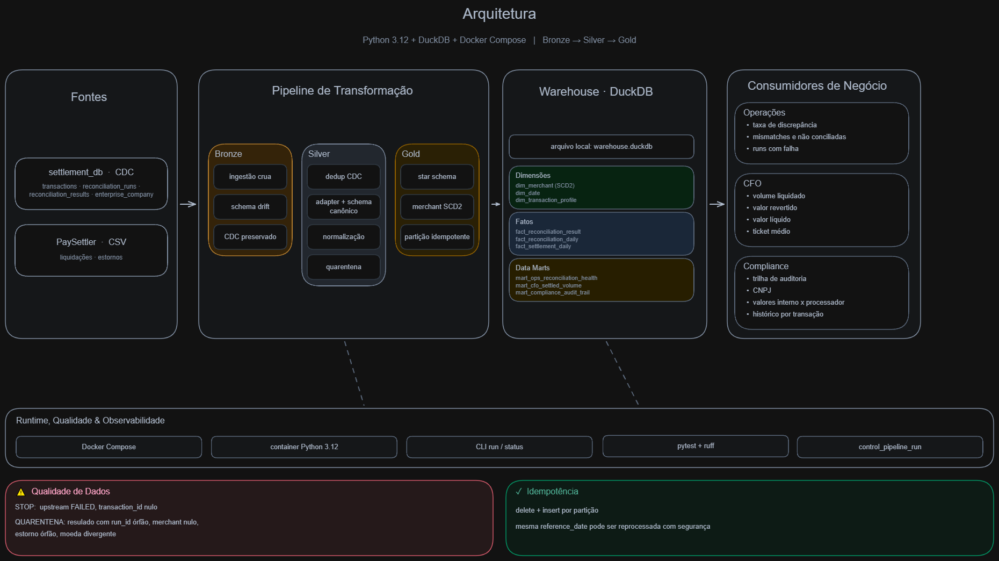
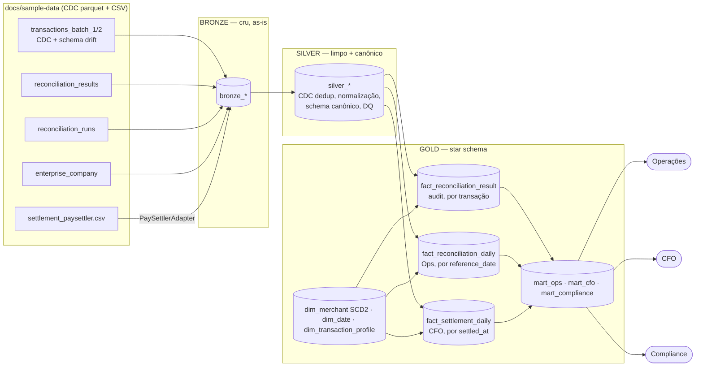
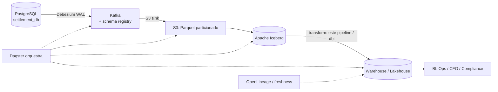

# Solução — Settlement Reconciliation Analytics

Pipeline analítico que transforma os dados do **Settlement Reconciliation Service** em
produtos de dados para **Operações**, **CFO** e **Compliance**. Stack: **Python 3.12 +
DuckDB + Docker Compose**, arquitetura **medalhão (bronze → silver → gold) + adapters**.

> Documento de design detalhado (decisões e tradeoffs): [`docs/design/decisoes-de-design.md`](docs/design/decisoes-de-design.md).

---

## Como rodar

### Local (Python)
```bash
python -m venv .venv && . .venv/Scripts/activate    # Windows; Linux: source .venv/bin/activate
pip install -e ".[dev]"

# processa uma data de referência (+ janela de 7 dias) e grava em warehouse.duckdb
python -m pipeline.cli run --reference-date 2025-03-16 --db warehouse.duckdb --data docs/sample-data

# inspeciona o histórico de execuções (observabilidade)
python -m pipeline.cli status --db warehouse.duckdb

# testes
pytest -v
```

### Docker
```bash
docker compose up -d --build
docker compose exec pipeline python -m pipeline.cli run --reference-date 2025-03-16
docker compose exec pipeline pytest -v
```
> `docker compose up` sobe o container **ocioso** (`tail -f /dev/null`) — o mesmo padrão do `Makefile` do desafio (`make up` + `make shell`/`make test`/`make run`). O pipeline é disparado via `exec` (acima), o que mantém o container como ambiente de execução reutilizável. *Em hosts sem o plugin `compose`, use `docker-compose` (hífen) ou `make <alvo> COMPOSE=docker-compose`.*

As queries de exemplo por consumidor estão em [`docs/queries/`](docs/queries/).

---

## Premissas e decisões

Todas validadas inspecionando os **dados reais** do fixture (não assumidas).

| # | Ambiguidade | Decisão | Por quê |
|---|---|---|---|
| D1 | Refazer a reconciliação ou consumir o resultado pronto? | **Consome** `reconciliation_results`. | O serviço já reconcilia; nosso produto é analytics sobre o resultado. |
| D2 | Papel do CSV PaySettler, já que o resultado existe? | **Feed canônico de liquidação**: enriquece (`settled_at`, `REVERSED`), faz cross-check e é o ponto de extensão. | `reconciliation_results` não tem `settled_at` nem status de reversão. |
| D3 | Tratamento do CDC (`Op`/`_timestamp`)? | Última versão por chave **e exclui `Op='D'`**. | Os dados reais têm `U` (update) e `D` (delete) — embora o gerador do repo só emita `I`. |
| D4 | Schema drift (`payment_method` só no batch 2)? | `read_parquet(..., union_by_name=true)`. | Unifica por nome; ausente vira NULL. |
| D5 | Histórico de atributos do merchant (SCD)? | **SCD Type 2** em `dim_merchant`. | Compliance precisa de auditoria "as-was"; Type 1 destruiria a trilha. |
| D6 | Granularidade temporal | Batch diário por `reference_date` + janela deslizante de 7 dias. | Janela de reconciliação do domínio. |
| D7 | Tolerância de valor | `difference <= R$ 0,01`. | Glossário. |
| D8 | Run upstream `FAILED` (2025-03-22)? | Data não é processada; falha registrada na tabela de controle. | Não propagar resultado de reconciliação incompleta. |
| D9 | `settled_amount` (CSV) ≠ `processor_amount` (results) por transação no fixture | Surfaço **ambos** na trilha de auditoria, sem assumir igualdade. | São fontes independentes no fixture; em produção eu adicionaria um check de DQ exigindo que reconciliem. |
| D10 | "Volume por dia" (CFO) e "saúde por dia" (Ops) têm semânticas de data diferentes | **Dois fatos diários**: `fact_reconciliation_daily` (por `reference_date` da run, grão por transação) p/ Ops; `fact_settlement_daily` (por `settled_at`) p/ CFO | Evita contar a mesma liquidação em várias runs (fan-out cross-date) e a mistura de grãos. |
| D11 | Surrogate keys precisam sobreviver entre runs (fatos persistem, dims são reconstruídas) | Chaves **determinísticas** (`dense_rank` sobre a chave natural), não sequência resetada | Um fato escrito numa run continua apontando pro merchant certo após outra run reconstruir a dimensão. |
| D12 | Results com `run_id` órfão (=99, 5 linhas) e `merchant_id` nulo (16 linhas) | **Quarentena** (`quarantine_results` + contagem), não descarte silencioso nem bucket NULL | Trilha de auditoria reconcilia com os results mantidos; nada some sem registro. |

**Descobertas nos dados reais** (provadas, ver `docs/design`): CDC com `U`/`D`; `id` **não-único** na união (dedup precisa de desempate determinístico via `rowid`); amounts em formato BR (`R$ 47.401,20`); 70 linhas de merchant → **50 distintos** (CDC); CSV com 510 linhas → **500 `transaction_id`** distintos; `reconciliation_results` com 837 linhas e 793 pares (txn, run) → grão do fato = **`result_id`**.

---

## Visão geral da arquitetura





> 🖼️ Diagrama detalhado (editável): [`docs/architecture.excalidraw`](docs/architecture.excalidraw) — abrir em [excalidraw.com](https://excalidraw.com).

**Módulos** (`pipeline/`): `cli` · `runner` (orquestra) · `config` (schema canônico + fontes) ·
`adapters/` (base + paysettler) · `bronze` · `silver` (dedup CDC + conformação) ·
`quality` (DQ) · `control` (watermark/observabilidade) · `gold` (dims/fatos/marts) · `db`.

### Modelo dimensional (gold) — 3 fatos + 3 dimensões + 3 marts
- **`fact_reconciliation_result`** — *transaction fact*, grão = 1 linha por `reconciliation_result` (degeneradas `result_id`, `transaction_id`, `reconciliation_run_id`). Trilha de auditoria imutável → **Compliance**. Merchant em **SCD2 as-was**.
- **`fact_reconciliation_daily`** — *periodic snapshot*, grão = `reference_date` × merchant × moeda, **colapsado por (transação, run)** (pior severidade vence). Taxas de discrepância → **Operações**.
- **`fact_settlement_daily`** — *periodic snapshot*, grão = `settled_at` × merchant × moeda, do **feed de liquidação** (1 linha/transação, sem fan-out). Volume liquidado/revertido/líquido + ticket médio → **CFO**.
- **`dim_merchant`** (SCD2, chave determinística), **`dim_date`** (role-playing: reference/settlement, padded), **`dim_transaction_profile`** (junk: categoria, tolerância, status, flags).

### Perguntas que o modelo responde (exemplos rodados no fixture, `--full`)
**Operações** — taxa de discrepância por dia (9 dias): varia `12,9%–15,8%`; runs com falha/rejeição via `control_pipeline_run` (rejeitadas=22).
**CFO** — volume liquidado por **dia de liquidação** × moeda × CNAE (todo o feed cai em 2025-03-16); líquido e ticket médio (~R$ 24–27 mil por setor).
**Compliance** — trilha completa por transação (com CNPJ); contagem de `UNRECONCILED_*`; ranking de CNPJ por `MISMATCHED`. Reconcilia: trilha = results mantidos (816), nada some em silêncio.
*Deliberadamente NÃO responde:* receita/fees (sem dado), tempo real (é batch), relatório regulatório formatado.

---

## Qualidade, idempotência, observabilidade, testes

- **Qualidade (3 camadas):** **conserta** na silver (vírgula/`R$`/timezone/caixa); **para** (circuit breaker) quando a run da data pedida não está `COMPLETED` ou há `transaction_id` nulo; **quarentena + conta** (orphan `REVERSED` → `quarantine_settlement` = 1; results com `run_id` órfão ou `merchant_id` nulo → `quarantine_results` = 21; liquidação com moeda divergente da transação interna → `quarantine_settlement` = 0 no fixture, tudo BRL). A quarentena roda **antes** de derivar `silver_settlement_current`, então as tabelas analíticas nunca veem linha quarentenada.
- **Idempotência:** reprocessa a janela `[ref-7d, ref]` substituindo cada partição com `BEGIN; DELETE … WHERE reference_date; INSERT …; COMMIT;` (atômico **por partição**, no mesmo `.duckdb`). Re-rodar a mesma data → contagens idênticas (teste automatizado). Chaves surrogate determinísticas mantêm fatos antigos consistentes com dims reconstruídas.
- **Observabilidade:** `control_pipeline_run` (run_id, status, rows_read/written/**rejected**, timestamps) — 1ª fonte no troubleshooting. Atomicidade é por-partição (não run-wide); o status reflete o desfecho da execução.
- **Testes:** **44 testes pytest** — dedup CDC (com delete), parser BR de valores, tolerância, quarentenas, **grão e reconciliação dos fatos**, **ausência de fan-out do CFO**, chaves determinísticas, **idempotência**, exit code não-zero em FAILED, e e2e da CLI.

---

## Extensibilidade — plugar um 2º processador

Schema **canônico de liquidação** (`config.CANONICAL_SETTLEMENT_COLUMNS`). Cada processador =
**1 adapter** (`adapters/<novo>.py`, implementa `SettlementAdapter.canonical_sql`) +
**1 entrada em `config.SOURCES`**. Silver e Gold operam só sobre o canônico → **não mudam**.

> **Resposta concreta:** ~**2 arquivos** (novo adapter + bloco de config) + testes do adapter.
> Nenhum módulo de transformação a jusante é tocado. Os testes existentes seguem válidos;
> roda-se a nova suíte do adapter.

---

## Limites deliberados do desenho

1. **Sem backfill de chegada tardia além da janela de 7 dias** — liquidação muito atrasada não reabre uma partição "fechada"; produção precisaria de replay sob demanda.
2. **Não é fonte de verdade da categorização** — consome `reconciliation_results`; erro do upstream se propaga. Produção desacoplaria com testes de contrato.
3. **DuckDB de processo único escritor** — sem múltiplos escritores nem serving concorrente de muitos usuários de BI no mesmo arquivo (ver Parte 3.3).
4. **Check de queda de volume não codado** — comparar direto com `runs.total_transactions` daria falso-positivo neste fixture (lá `total_transactions` conta linhas do CSV, não `results`); um check honesto exigiria baseline histórico (média móvel), que 1 dia de CSV de exemplo não permite validar. *(A divergência de moeda interno×processador, ao contrário, **está implementada** como quarentena.)*
5. **Atomicidade por-partição, não run-wide** — uma falha após uma partição já commitada deixa essa partição gravada (o re-run é seguro por ser idempotente), e o enriquecimento de liquidação na trilha de auditoria reflete a **última** liquidação da transação. No modo `--full`, os fatos são limpos antes do rebuild — há uma janela curta de tabela vazia se o processo morrer no meio (o re-run idempotente recompõe).

---

## Parte 3 — Produção

### 3.1 Arquitetura de produção

O **core de transformação** (bronze/silver/gold em DuckDB) é o mesmo localmente e em produção
— trocando o armazenamento de um `.duckdb` por Iceberg + engine distribuída quando necessário.

### 3.2 Troubleshooting — "dashboards sem dados desde sexta"
Ordem do sintoma à origem: **(1)** `control_pipeline_run` — última run `SUCCESS`? alguma `FAILED`/`RUNNING` travada? **(2)** histórico do orquestrador — a run de sexta rodou, falhou, ou rodou sobre input velho? **(3)** logs por `run_id` + `run_results` localizando o nó parado. **(4)** frescor das fontes (último parquet/arquivo). **(5)** só então CDC: lag do slot do Debezium via `pg_replication_slots` (distância de LSN; `active_pid` nulo = conector caído). **Não** assumir CDC antes de checar o orquestrador.

### 3.3 Escalabilidade (→ ~5M transações/dia, ≈1,8B/ano)
O gargalo **não é volume** — 1,8B linhas/ano cabe num nó (DuckDB faz out-of-core e já rodou TPC-H em escala de TB). Quebra primeiro em **concorrência** (1 processo escritor) e **serving multiusuário**. Caminho: particionar por data; separar ingestão de serving; migrar de `.duckdb` único para **Iceberg + engine distribuída** (Spark/Trino) ou **DW** (BigQuery/Snowflake/ClickHouse) **quando a concorrência exigir** — mantendo DuckDB para dev/embedded.

---

## O que faria diferente em produção
dbt para as transformações (testes/docs/linhagem nativos); SCD2 incremental com chaves persistidas; particionamento físico (Hive/Iceberg) em vez de tabela única; checks de DQ como contratos versionados (Great Expectations/Soda) emitindo via OpenLineage; alertas de frescor com SLA.

## Ferramentas de IA utilizadas
Usei o **Claude (Anthropic)** como par de programação: pesquisa e **verificação com fontes** das capacidades do DuckDB (`MERGE INTO`, `union_by_name`, `QUALIFY`) e de padrões de modelagem (Kimball); geração de scaffolding de código e testes a partir das decisões de design; e revisão. **As decisões de arquitetura e modelagem foram tomadas, validadas contra os dados reais e documentadas por mim** — o spec em [`docs/design/`](docs/design/) registra cada decisão (D1–D12) e o porquê.
