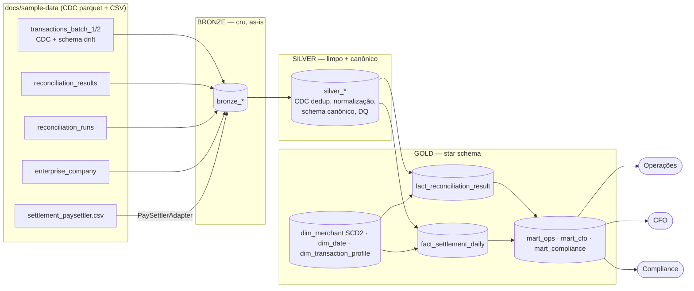
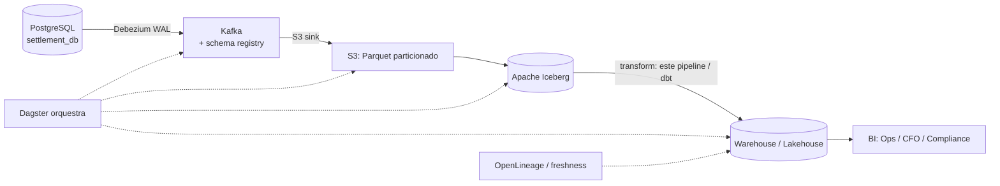

# Solução — Settlement Reconciliation Analytics

Pipeline analítico que transforma os dados do **Settlement Reconciliation Service** em
produtos de dados para **Operações**, **CFO** e **Compliance**. Stack: **Python 3.12 +
DuckDB + Docker Compose**, arquitetura **medalhão (bronze → silver → gold) + adapters**.

> Documento de design detalhado (decisões e tradeoffs): [`docs/design/2026-06-14-settlement-reconciliation-analytics-design.md`](docs/design/2026-06-14-settlement-reconciliation-analytics-design.md).

---

## Como rodar

### Local (Python)
```bash
python -m venv .venv && . .venv/Scripts/activate    # Windows; Linux: source .venv/bin/activate
pip install -e ".[dev]"

# processa uma data de referência (+ janela de 7 dias) e grava em warehouse.duckdb
python -m pipeline.cli run --reference-date 2025-03-16 --db warehouse.duckdb --data docs/sample-data

# inspeciona o histórico de execuções (observabilidade)
python -m pipeline.cli status --db warehouse.duckdb

# testes
pytest -v
```

### Docker
```bash
docker compose up -d --build
docker compose exec pipeline python -m pipeline.cli run --reference-date 2025-03-16
docker compose exec pipeline pytest -v
```

As queries de exemplo por consumidor estão em [`docs/queries/`](docs/queries/).

---

## Premissas e decisões

Todas validadas inspecionando os **dados reais** do fixture (não assumidas).

| # | Ambiguidade | Decisão | Por quê |
|---|---|---|---|
| D1 | Refazer a reconciliação ou consumir o resultado pronto? | **Consome** `reconciliation_results`. | O serviço já reconcilia; nosso produto é analytics sobre o resultado. |
| D2 | Papel do CSV PaySettler, já que o resultado existe? | **Feed canônico de liquidação**: enriquece (`settled_at`, `REVERSED`), faz cross-check e é o ponto de extensão. | `reconciliation_results` não tem `settled_at` nem status de reversão. |
| D3 | Tratamento do CDC (`Op`/`_timestamp`)? | Última versão por chave **e exclui `Op='D'`**. | Os dados reais têm `U` (update) e `D` (delete) — embora o gerador do repo só emita `I`. |
| D4 | Schema drift (`payment_method` só no batch 2)? | `read_parquet(..., union_by_name=true)`. | Unifica por nome; ausente vira NULL. |
| D5 | Histórico de atributos do merchant (SCD)? | **SCD Type 2** em `dim_merchant`. | Compliance precisa de auditoria "as-was"; Type 1 destruiria a trilha. |
| D6 | Granularidade temporal | Batch diário por `reference_date` + janela deslizante de 7 dias. | Janela de reconciliação do domínio. |
| D7 | Tolerância de valor | `difference <= R$ 0,01`. | Glossário. |
| D8 | Run upstream `FAILED` (2025-03-22)? | Data não é processada; falha registrada na tabela de controle. | Não propagar resultado de reconciliação incompleta. |
| D9 | `settled_amount` (CSV) ≠ `processor_amount` (results) por transação no fixture | Surfaço **ambos** na trilha de auditoria, sem assumir igualdade. | São fontes independentes no fixture; em produção eu adicionaria um check de DQ exigindo que reconciliem. |

**Descobertas nos dados reais** (provadas, ver `docs/design`): CDC com `U`/`D`; `id` **não-único** na união (dedup precisa de desempate determinístico via `rowid`); amounts em formato BR (`R$ 47.401,20`); 70 linhas de merchant → **50 distintos** (CDC); CSV com 510 linhas → **500 `transaction_id`** distintos; `reconciliation_results` com 837 linhas e 793 pares (txn, run) → grão do fato = **`result_id`**.

---

## Visão geral da arquitetura



**Módulos** (`pipeline/`): `cli` · `runner` (orquestra) · `config` (schema canônico + fontes) ·
`adapters/` (base + paysettler) · `bronze` · `silver` (dedup CDC + conformação) ·
`quality` (DQ) · `control` (watermark/observabilidade) · `gold` (dims/fatos/marts) · `db`.

### Modelo dimensional (gold)
- **`fact_reconciliation_result`** — grão = 1 linha por `reconciliation_result` (degenerada `result_id`, `transaction_id`, `reconciliation_run_id`). Trilha de auditoria → **Compliance**.
- **`fact_settlement_daily`** — periodic snapshot, grão = merchant × moeda × dia. Linhas densas → tendências sem buraco. Serve **Operações** (taxas) e **CFO** (volume).
- **`dim_merchant`** (SCD2), **`dim_date`** (role-playing: reference/settlement), **`dim_transaction_profile`** (junk: categoria, tolerância, status, flags).

### Perguntas que o modelo responde (exemplos rodados no fixture)
**Operações** — taxa de discrepância por dia: `13,2% → 12,7% → 12,2%` (03-10/13/16); runs com falha/rejeição (`control_pipeline_run`).
**CFO** — volume por dia/moeda/CNAE; ticket médio `R$ 11.321 / 9.763 / 12.443`.
**Compliance** — trilha completa por transação (com CNPJ); `UNRECONCILED_PROCESSOR=7`, `UNRECONCILED_INTERNAL=6`; ranking de CNPJ por `MISMATCHED`.
*Deliberadamente NÃO responde:* receita/fees (sem dado), tempo real (é batch), relatório regulatório formatado.

---

## Qualidade, idempotência, observabilidade, testes

- **Qualidade (3 camadas):** **conserta** na silver (vírgula/`R$`/timezone/caixa); **para** (circuit breaker) em ameaça à integridade (run `FAILED`, `transaction_id` nulo); **quarentena + alerta** (orphan `REVERSED` → `quarantine_settlement`; 1 caso no fixture). Decisão explícita do que para vs. alerta.
- **Idempotência:** reprocessa a janela `[ref-7d, ref]` substituindo cada partição com `BEGIN; DELETE … WHERE reference_date; INSERT …; COMMIT;` num único arquivo `.duckdb`. Teste automatizado roda 2× a mesma data → contagens idênticas.
- **Observabilidade:** `control_pipeline_run` (run_id, status, rows_read/written/rejected, timestamps) atualizada na mesma transação do dado → status nunca mente. É a 1ª fonte no troubleshooting.
- **Testes:** **35 testes pytest** — unit das transformações (dedup CDC com delete, parser BR, tolerância), 1 por check de DQ, grão dos fatos, **idempotência**, e e2e da CLI.

---

## Extensibilidade — plugar um 2º processador

Schema **canônico de liquidação** (`config.CANONICAL_SETTLEMENT_COLUMNS`). Cada processador =
**1 adapter** (`adapters/<novo>.py`, implementa `SettlementAdapter.canonical_sql`) +
**1 entrada em `config.SOURCES`**. Silver e Gold operam só sobre o canônico → **não mudam**.

> **Resposta concreta:** ~**2 arquivos** (novo adapter + bloco de config) + testes do adapter.
> Nenhum módulo de transformação a jusante é tocado. Os testes existentes seguem válidos;
> roda-se a nova suíte do adapter.

---

## Limites deliberados do desenho

1. **Sem backfill de chegada tardia além da janela de 7 dias** — liquidação 10 dias atrasada cai na quarentena; produção precisaria de replay/reabertura de partição sob demanda.
2. **Não é fonte de verdade da categorização** — consome `reconciliation_results`; erro do upstream se propaga. Produção desacoplaria com testes de contrato.
3. **DuckDB de processo único escritor** — sem múltiplos escritores nem serving concorrente de muitos usuários de BI no mesmo arquivo.
4. **Surrogate keys regeneradas a cada run** (`dim_merchant`) — simplificação; produção persistiria as chaves e versionaria SCD2 incrementalmente.

---

## Parte 3 — Produção

### 3.1 Arquitetura de produção

O **core de transformação** (bronze/silver/gold em DuckDB) é o mesmo localmente e em produção
— trocando o armazenamento de um `.duckdb` por Iceberg + engine distribuída quando necessário.

### 3.2 Troubleshooting — "dashboards sem dados desde sexta"
Ordem do sintoma à origem: **(1)** `control_pipeline_run` — última run `SUCCESS`? alguma `FAILED`/`RUNNING` travada? **(2)** histórico do orquestrador — a run de sexta rodou, falhou, ou rodou sobre input velho? **(3)** logs por `run_id` + `run_results` localizando o nó parado. **(4)** frescor das fontes (último parquet/arquivo). **(5)** só então CDC: lag do slot do Debezium via `pg_replication_slots` (distância de LSN; `active_pid` nulo = conector caído). **Não** assumir CDC antes de checar o orquestrador.

### 3.3 Escalabilidade (→ ~5M transações/dia, ≈1,8B/ano)
O gargalo **não é volume** — 1,8B linhas/ano cabe num nó (DuckDB faz out-of-core e já rodou TPC-H em escala de TB). Quebra primeiro em **concorrência** (1 processo escritor) e **serving multiusuário**. Caminho: particionar por data; separar ingestão de serving; migrar de `.duckdb` único para **Iceberg + engine distribuída** (Spark/Trino) ou **DW** (BigQuery/Snowflake/ClickHouse) **quando a concorrência exigir** — mantendo DuckDB para dev/embedded.

---

## O que faria diferente em produção
dbt para as transformações (testes/docs/linhagem nativos); SCD2 incremental com chaves persistidas; particionamento físico (Hive/Iceberg) em vez de tabela única; checks de DQ como contratos versionados (Great Expectations/Soda) emitindo via OpenLineage; alertas de frescor com SLA.

## Ferramentas de IA utilizadas
Usei o **Claude (Anthropic)** como par de programação: pesquisa e **verificação com fontes** das capacidades do DuckDB (`MERGE INTO`, `union_by_name`, `QUALIFY`) e de padrões de modelagem (Kimball); geração de scaffolding de código e testes a partir das decisões de design; e revisão. **As decisões de arquitetura e modelagem foram tomadas, validadas contra os dados reais e documentadas por mim** — o spec em [`docs/design/`](docs/design/) registra cada decisão (D1–D9) e o porquê.
