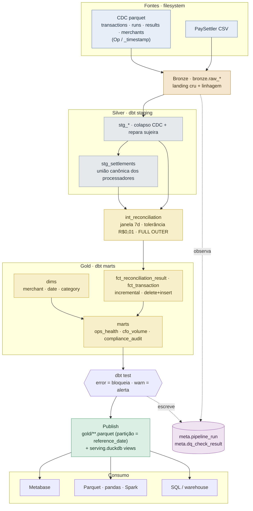

# PR — Settlement Reconciliation Data Products

> Conteúdo para a descrição do Pull Request. Detalhes técnicos aprofundados estão
> em [`SOLUTION.md`](../SOLUTION.md) e em `docs/`.

---

## Como rodar

Pré-requisitos: Docker + Docker Compose.

```bash
# 1. Subir o ambiente (container leve: DuckDB + dbt)
docker compose up -d --build

# 2. Rodar o pipeline completo para uma data de referência
#    (ingest Bronze -> dbt build [Silver/Gold + testes] -> publish dos produtos)
make run                      # default REFERENCE_DATE=2025-03-16 (data do CSV de exemplo)
make run REFERENCE_DATE=2025-03-13   # outra data

# 3. Rodar os testes (correção da reconciliação + idempotência + publish)
make test

# 4. Consumir os produtos de dados publicados (Parquet, sem tocar no warehouse)
docker compose exec pipeline duckdb -c \
  "select * from read_parquet('gold/mart_ops_health/**/*.parquet', hive_partitioning=true)"
#    ou as queries de exemplo por consumidor:
docker compose exec pipeline duckdb warehouse/settlement.duckdb < sql/examples/ops_health.sql
```

Opcionais:
```bash
make bi-up        # Metabase sobre os produtos publicados -> http://localhost:3000
make airflow-up   # orquestração Airflow (DAG diária) -> http://localhost:8080
make scale-test   # gera ~1M linhas e roda o pipeline contra elas
make help         # lista todos os alvos
```

Como o negócio consome os dados: [`docs/consumption.md`](consumption.md).

---

## Premissas e decisões

**Ambiguidades encontradas e como resolvi:**

- **Recalcular a reconciliação vs. ingerir os resultados prontos.** O fixture já traz
  `reconciliation_results`, mas o gerador planta armadilhas (REVERSED órfão, liquidação
  fora da janela) que só um motor de reconciliação de verdade exercita. **Decisão:
  recalcular** a categorização a partir das fontes cruas (`int_reconciliation`), usando os
  resultados fornecidos apenas como sinal de cross-check.
- **O CSV de exemplo NÃO corresponde 1:1 aos resultados históricos.** Investigando os dados:
  `settlement_paysettler.csv` tem 510 linhas todas com `settled_at=2025-03-16`, cobrindo
  transações do mês inteiro, com diferença de valor semeada em toda transação sobreposta —
  já o run 5 (mesma data) processou 98 transações. **É um fixture sintético**, não o arquivo
  que gerou os resultados históricos. Consequência: um recálculo contra ele dá ~0 MATCHED
  (esperado, não é bug). Por isso a **corretude é provada com fixtures controlados**
  (`tests/test_reconciliation.py`, entradas conhecidas → categorias conhecidas) e o
  cross-check é um teste `warn`. Detalhes em [`docs/data-products.md`](data-products.md).
- **`reference_date`.** Derivada do `settled_at` do arquivo (em produção viria do nome
  `settlement_YYYYMMDD_*.csv`). Janela de 7 dias aplicada ao `created_at` interno,
  `[reference_date − 7, reference_date]`, inclusiva; match por `transaction_id`; tolerância
  R$ 0,01.
- **CDC + schema drift.** As fontes internas são extrações estilo Debezium (`Op`/`_timestamp`);
  `transactions_batch_2` tem uma coluna a mais (`payment_method`). Colapso de CDC no staging
  (última versão por chave, descarta deletes) e drift absorvido no Bronze (`union_by_name`).
- **Idempotência.** `delete+insert` na chave natural, particionado por `reference_date` —
  rodar a mesma data duas vezes não duplica; falha no meio + retry não corrompe.
- **Qualidade de dados: bloquear vs. alertar.** Integridade (`severity: error`) bloqueia
  (PK nula/duplicada, valor não parseável, moeda fora do ISO, quebra de contrato); anomalia
  (`severity: warn`) alerta sem bloquear (spike de mismatch/órfãos, drift vs. fonte).
- **Dinheiro em pt-BR.** O feed traz valores como `R$ 1.234,56` (símbolo, `.` milhar, `,`
  decimal). Macro `clean_amount` normaliza deterministicamente; o que sobrar não-parseável
  vira NULL e é **bloqueado** pelo gate de integridade — em vez de coagir silenciosamente.

---

## Visão geral da arquitetura

Medallion (Bronze → Silver → Gold) sobre **DuckDB + dbt**, orquestrado por **Airflow**,
com uma camada de **publicação** que serve produtos de dados consumíveis.



<sub>📎 Se o Mermaid não renderizar no seu visualizador: [PNG estático](img/pipeline.png).</sub>

Orquestração: DAG Airflow `ingest ▶ dbt run ▶ dbt test ▶ publish` (sequencial — DuckDB é
single-writer). Estrutura: `src/pipeline/` (ingest + CLI + publish), `dbt/`
(models/tests/macros), `airflow/dags/`, `sql/examples/`, `tests/`, `docs/`. **Diagrama do DAG
e topologia de produção** (também em Mermaid) em [`docs/architecture.md`](architecture.md).

---

## Extensibilidade

**Cenário: plugar um segundo processador (ex.: "AcmePay"), schema parecido mas não idêntico.**

A arquitetura tem uma **costura canônica** exatamente para isso: o motor de reconciliação lê
`stg_settlements` (stream canônico), não um processador específico. Cada processador é um
**adaptador** de staging que mapeia seu schema para o mesmo contrato.

**Caminho concreto — o que muda:**

| # | Arquivo | Mudança | ~Linhas |
|---|---------|---------|---------|
| 1 | `src/pipeline/ingest/bronze.py` | +1 entrada em `PROCESSOR_SOURCES` (`"raw_acmepay": "settlement_acmepay.csv"`). O Bronze passa a landar o arquivo automaticamente. | +1 |
| 2 | `dbt/models/staging/stg_acmepay.sql` | **1 arquivo novo**: adaptador que mapeia as colunas do AcmePay ("similar mas não idêntico" — ex.: `txn_uuid`→`transaction_id`, valor em centavos, TZ diferente) para o contrato canônico. Reaproveita a macro `clean_amount`. | ~30 (novo) |
| 3 | `dbt/models/staging/stg_settlements.sql` | +1 bloco `union all` referenciando `stg_acmepay` com `'acmepay' as source_system`. | ~6 |
| 4 | `dbt/models/staging/_staging.yml` | (opcional) testes do novo adaptador. | ~8 |

**O que NÃO muda:** `int_reconciliation` (o motor), os fatos, os marts, a idempotência, os
gates de DQ e **todos os testes de reconciliação** — porque testam o stream canônico, não um
processador. A coluna `processor_source` já propaga automaticamente até o fato e o mart de
compliance, então cada linha fica etiquetada com qual processador liquidou. Colisão do mesmo
`transaction_id` vindo de dois processadores já é tratada (dedup por `settled_at` mais recente).

**O que roda de novo:** `dbt build` (models + testes) e `pytest`. Total: **~1 arquivo novo
(~30 linhas) + ~7 linhas em 2 arquivos existentes** (+ testes opcionais).

---

## Limites do desenho (o que deliberadamente não suporto hoje)

1. **DuckDB single-writer / single-node.** Um único processo escreve, um único arquivo. Ótimo
   para o volume do desafio, mas **quebra primeiro** em ~5M/dia: não há escrita concorrente
   nem leitura+escrita simultânea no mesmo arquivo, e 1,8B linhas/ano não cabem num arquivo.
   Produção exige warehouse distribuído (Snowflake/BigQuery) com storage/compute separados.
2. **Sem histórico ponto-no-tempo do merchant (SCD2).** `dim_merchant` é current-state. Se a
   razão social ou o CNAE de um merchant mudarem, uma auditoria de um dia passado mostra a
   identidade **atual**, não a vigente na `reference_date`. Compliance de produção precisaria de
   SCD2 (dbt snapshot sobre `_timestamp`).
3. **Ingestão full-replace, sem CDC incremental nem tratamento de chegada tardia.** A cada run
   recarrego a fonte inteira e não processo deltas de CDC incrementalmente. Uma transação
   interna que chega **depois** de a `reference_date` já ter sido reconciliada só é capturada
   num backfill manual (re-run) — não há detecção/re-processamento automático. Produção
   precisaria de ingestão incremental (Debezium→Kafka, landing particionado) + estratégia de
   late-arrival/backfill.
4. **Sem consciência de câmbio (FX).** Um interno em USD vs. processador em BRL é categorizado
   `MISMATCHED` (moedas diferentes não são comparáveis) e cada moeda é reportada no seu próprio
   grão; **não há conversão FX** para um total consolidado. Multi-moeda com conversão exigiria uma
   camada de câmbio.

> Todos os achados das revisões automáticas (CodeRabbit + Codex) — o que foi corrigido, o que foi
> **deliberadamente adiado e por quê**, com o gatilho concreto de revisão — estão em
> [`docs/review-decisions.md`](review-decisions.md).

---

## O que faria diferente em produção

**O que simplifiquei (e o que produção precisaria):**

| Simplificação local | Produção |
|---|---|
| Fontes como parquet CDC no filesystem | CDC real: Debezium → Kafka → landing particionado em object storage (S3/GCS) |
| DuckDB, arquivo único | Warehouse distribuído (Snowflake/BigQuery), fato particionado/clusterizado por `reference_date`; `MERGE` nativo |
| Bronze full-replace | Ingestão incremental por partição (O(dados novos), não O(total)) |
| Airflow standalone + SequentialExecutor + SQLite | LocalExecutor/Celery + Postgres; alertas e SLAs de `source freshness`; dynamic task mapping por partição |
| `dim_merchant` current-state | SCD2 via dbt snapshot |
| CNPJ em texto claro | Tratamento de PII: masking/tokenização, tags no contrato de dados, controle de acesso |
| Sem segredos (tudo local) | Secrets manager, conexões gerenciadas |
| Observabilidade em tabelas DuckDB | `meta.pipeline_run`/`meta.dq_check_result` + artefatos dbt → Datadog/Grafana; alerta em `warn` e em runs FAILED |

O ponto central: **a lógica de negócio (medallion, regras de reconciliação, idempotência, split
error/warn) sobrevive à troca de substrato** — o mesmo projeto dbt roda em Snowflake/BigQuery só
trocando o adapter em `profiles.yml`. Escala em [`docs/scalability.md`](scalability.md);
runbook de troubleshooting em [`docs/troubleshooting.md`](troubleshooting.md).

---

## Ferramentas de IA utilizadas

### Quais ferramentas

- **Claude Code** (CLI da Anthropic, modelo Claude Opus) — agente principal de engenharia,
  usado ponta a ponta como par de programação.
- **AgentSpec** (plugin de *spec-driven development* rodando sobre o Claude Code) — conduziu um
  fluxo em fases `/brainstorm → /define → /design → /build`, gerando artefatos versionados em
  `.claude/sdd/features/` (BRAINSTORM/DEFINE/DESIGN, com ADRs). Ou seja: a IA foi usada para
  **estruturar a decisão antes de escrever código**, não só para gerar código.
- **Ferramentas não-IA usadas para *verificar* a IA:** `dbt-duckdb` + `pytest` + `ruff`
  (execução real de cada camada) e `mermaid-cli` (render/validação dos diagramas).

### Para quê (com exemplos concretos)

- **Exploração e entendimento dos dados:** consultas DuckDB guiadas por IA sobre os fixtures —
  foi assim que descobrimos que o CSV de exemplo é sintético e não bate 1:1 com os resultados
  históricos (decisão de provar corretude com fixtures controlados).
- **Design e trade-offs:** medallion + dbt + Airflow, a idempotência (`delete+insert` na chave
  natural), o split de DQ error/warn e a costura `stg_settlements` — sempre com as alternativas
  registradas nos ADRs.
- **Geração de código:** modelos dbt, ingest Python, CLI, macros, DAG, testes e docs.
- **Debug:** caçar bugs reais durante a construção — o dinheiro pt-BR (`R$ 1.234,56`) que exigiu
  a macro `clean_amount`; um auto-lock (a CLI segurava conexão de escrita no DuckDB enquanto
  chamava o dbt — o próprio single-writer que o design antecipa); um `ref()` de exemplo em
  comentário que o dbt ainda parseava (corrigido com comentário Jinja).
- **Documentação e diagramas:** este PR, `README`, `SOLUTION.md`, `docs/` e os diagramas Mermaid.

### Como trabalho com a IA — confiar e verificar

As **decisões de negócio e arquitetura foram minhas**; o papel da IA foi expor alternativas,
acelerar a implementação e servir de checklist. Cada camada gerada foi **executada contra os
dados reais** e só aceita quando passava — 16 testes do pipeline verdes (25 no total com os
smoke tests do gerador), ruff limpo, diagramas renderizados.
Sou explícito sobre o que **não** consegui validar sem infraestrutura: o container do Metabase
(driver de comunidade DuckDB↔Metabase, versões que oscilam) — por isso a URL do driver é
sobrescrevível e está documentada, e os produtos Parquet independem dele. Essa disciplina de
*trust-but-verify* — nunca aceitar saída de IA sem rodá-la — é o principal motivo de a solução
funcionar de fato, e não só parecer plausível.
