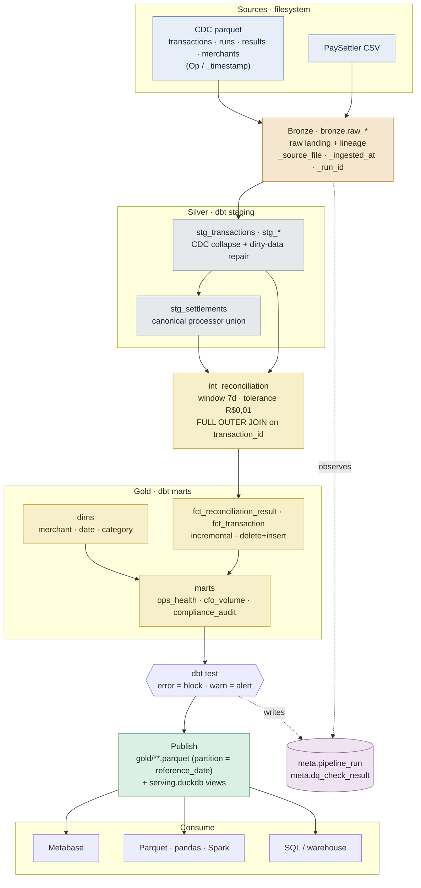
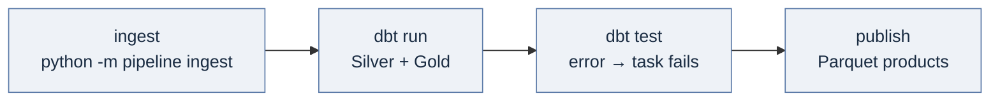
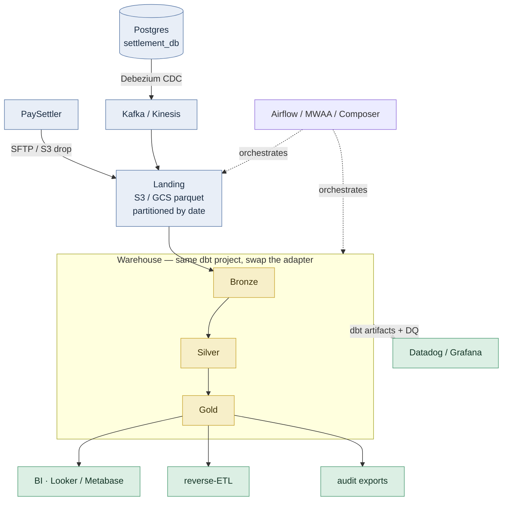

# Part 3.1 — Architecture

> Diagrams are [Mermaid](https://mermaid.js.org/) and render automatically on GitHub
> (in the PR / file view). ASCII fallbacks live in the git history of this file.

## Local pipeline (this repository)

📎 If Mermaid doesn't render in your viewer: [static PNG](img/pipeline.png).

- **Ingest (Python + DuckDB):** lands each source into `bronze` with lineage columns,
  streaming parquet under a `memory_limit` so a 5M-row file never needs to fit in RAM.
  Transactional full-replace → Bronze is idempotent.
- **Transform (dbt-duckdb):** staging collapses CDC to current state and repairs dirty
  data; `stg_settlements` is the canonical processor seam; `int_reconciliation`
  recomputes categories; marts are incremental (`delete+insert` on the natural key).
- **Quality gates (dbt test):** integrity (`error`) blocks, anomaly (`warn`) alerts;
  every result lands in `meta.dq_check_result`.
- **Publish:** Gold → partitioned Parquet products + a `serving.duckdb` view catalog,
  so consumers never touch the single-writer warehouse.

## Orchestration (Airflow DAG)

📎 Static PNG fallback: [dag.png](img/dag.png).

Linear and **sequential** because DuckDB is single-writer — one task holds the warehouse
file at a time. Parametrized by `reference_date` (the run's logical date), `retries=2`;
idempotency makes every retry/backfill safe.

## Production topology (how this maps to the cloud)

📎 Static PNG fallback: [production.png](img/production.png).

The **dbt project is portable**: the same models run on Snowflake/BigQuery by changing the
adapter in `profiles.yml`. Bronze becomes a partitioned object-store landing zone; ingest
becomes CDC (Debezium→Kafka) instead of a batch parquet extract. The medallion layering,
the reconciliation logic, the idempotency strategy, and the DQ gates are unchanged — only
the substrate scales (see [`scalability.md`](scalability.md)).

## Key design decisions (full ADRs in the DESIGN doc)

| Decision | Why |
|---|---|
| Recompute reconciliation (don't ingest results) | Owns the domain logic; exercises the dirty-data traps; testable |
| Idempotency = delete+insert on natural key, per `reference_date` | Re-runs / backfills / retries never duplicate or corrupt |
| DQ = dbt `error` (integrity) vs `warn` (anomaly) | Block on structural breakage, alert on distribution drift |
| CDC collapse in staging (latest-per-key, drop deletes) | Deterministic current state without a stateful CDC engine |
| Canonical `stg_settlements` seam | Adding a processor = one adapter + one union line, engine unchanged |
| Publish to Parquet + serving views | Consumers decoupled from the single-writer warehouse |
| Sequential Airflow DAG | Respects DuckDB single-writer |
