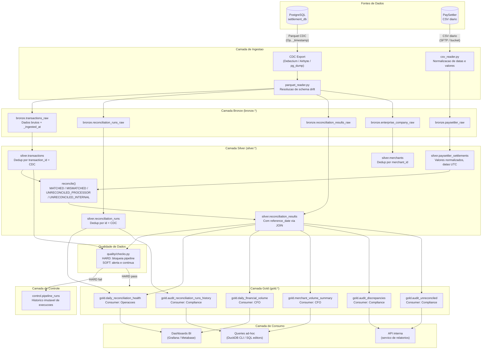
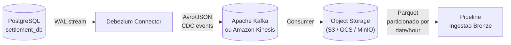
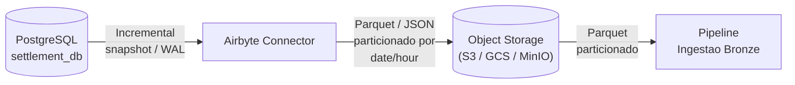
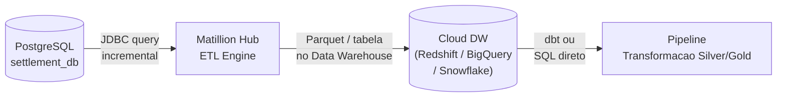
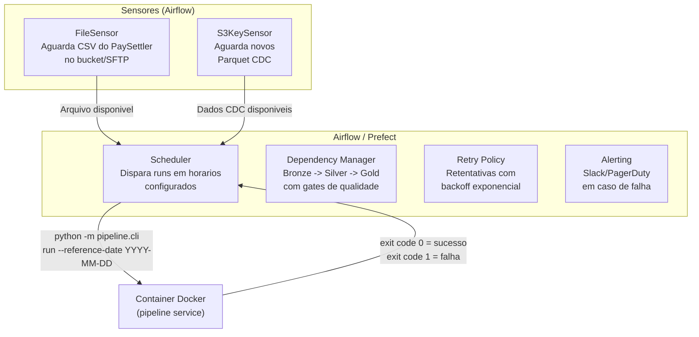

# Arquitetura da Plataforma de Reconciliacao de Liquidadades

## Diagrama de Fluxo de Dados



---

## Descricao dos Componentes

### Fontes de Dados

| Componente | Responsabilidade | Formato | Frequencia |
|---|---|---|---|
| **PostgreSQL (`settlement_db`)** | Sistema transacional de registro. Contem as tabelas `transactions`, `reconciliation_runs`, `reconciliation_results` e `enterprise_company`. | Relacional | Continuo (OLTP) |
| **PaySettler (CSV)** | Arquivo diario enviado pelo processador externo com as transacoes liquidadas nas ultimas 24h. Contem `transaction_id`, `merchant_id`, `amount`, `settled_at`, `processor_reference`, `status`. | CSV (UTF-8, virgula) | Diario |

### Camada de Ingestao

| Componente | Responsabilidade |
|---|---|
| **`parquet_reader.py`** | Le os arquivos Parquet exportados do PostgreSQL via CDC. Resolve schema drift entre batches (colunas divergentes) usando `COALESCE` para preencher colunas ausentes com NULL. Cria view unificada `raw_transactions`. |
| **`csv_reader.py`** | Le o CSV do PaySettler. Normaliza campos sujos: remove simbolos de moeda (R$), converte formato brasileiro de decimal (virgula) para ponto, garante sufixo `Z` em timestamps UTC, normaliza `merchant_id` para upper case. |

### Camada Bronze (`bronze.*`)

Dados brutos sem nenhuma transformacao de negocio. Adiciona apenas metadados de ingestao:

- `_ingested_at`: timestamp UTC do momento da ingestao
- `_source_file`: nome do arquivo de origem
- `_reference_date`: data de referencia da execucao

Tabelas: `transactions_raw`, `reconciliation_runs_raw`, `reconciliation_results_raw`, `paysettler_raw`, `enterprise_company_raw`.

Principio: se o dado veio errado da fonte, ele entra errado no bronze. Nenhuma regra de negocio e aplicada nesta camada.

### Camada Silver (`silver.*`)

Dados limpos, deduplicados e integrados:

| Tabela | Transformacao Principal |
|---|---|
| `silver.transactions` | Deduplicacao por `transaction_id` mantendo o registro com `_timestamp` mais recente (semantica CDC). Rejeicao de registros com `transaction_id` nulo (HARD). Normalizacao de tipos (datas para UTC). |
| `silver.reconciliation_runs` | Deduplicacao por `id` mantendo o registro com `_timestamp` mais recente. |
| `silver.reconciliation_results` | Carregada a partir dos dados CDC com JOIN em `reconciliation_runs` para obter `reference_date`. A reconciliacao do pipeline (`reconcile()`) tambem escreve nesta tabela usando estrategia DELETE+INSERT por `reference_date`. |
| `silver.paysettler_settlements` | Passagem direta do bronze com tipos normalizados. |
| `silver.merchants` | Deduplicacao por `merchant_id` mantendo o registro com `_timestamp` mais recente. |

### Reconciliacao (`reconciliation.py`)

Logica central que compara transacoes internas contra liquidacoes do PaySettler:

- **MATCHED**: `transaction_id` encontrado em ambos os lados, diferenca absoluta <= R$ 0,01 (tolerancia configuravel)
- **MISMATCHED**: `transaction_id` encontrado em ambos os lados, diferenca absoluta > R$ 0,01
- **UNRECONCILED_PROCESSOR**: existe no PaySettler mas nao foi encontrado nas transacoes internas dentro da janela de 7 dias
- **UNRECONCILED_INTERNAL**: existe nas transacoes internas (janela de 7 dias) mas nao foi encontrado no PaySettler

Idempotencia: antes de inserir resultados, remove registros existentes para o mesmo `reference_date` (`DELETE FROM silver.reconciliation_results WHERE reference_date = ?`).

### Qualidade de Dados (`quality/checks.py`)

Checks classificados como HARD (bloqueiam o pipeline) ou SOFT (geram alerta mas nao interrompem):

| Check | Tipo | Logica |
|---|---|---|
| `null_transaction_id_in_results` | HARD | Conta registros com `transaction_id` nulo em `silver.reconciliation_results` |
| `negative_amount_in_transactions` | HARD | Conta registros com `amount < 0` em `silver.transactions` |
| `empty_csv` | HARD | Verifica se o CSV do PaySettler tem zero linhas de dados |
| `duplicate_transaction_id_in_run` | SOFT | Verifica duplicatas de `transaction_id` por `reference_date` |
| `mismatch_rate_above_threshold` | SOFT | Alerta se taxa de MISMATCHED ultrapassa 20% |
| `orphan_merchants` | SOFT | Verifica `merchant_id` nos resultados sem cadastro em `silver.merchants` |
| `schema_drift_logged` | SOFT | Registra diferencas de schema entre batches de Parquet |

Se qualquer check HARD falhar, o pipeline aborta e marca a run como `FAILED`.

### Camada Gold (`gold.*`)

Tabelas prontas para consumo, sempre derivadas do Silver, nunca de dados brutos:

| Tabela | Consumer | Conteudo |
|---|---|---|
| `gold.daily_reconciliation_health` | Operacoes | Taxa de discrepancia, volumes nao-reconciliados, tempo de processamento por run |
| `gold.daily_financial_volume` | CFO | Volume interno, volume processador e diferenca acumulada por dia |
| `gold.merchant_volume_summary` | CFO | Volume por merchant (top N), contagem de mismatches |
| `gold.audit_discrepancies` | Compliance | Todas as transacoes MISMATCHED com valores de ambos os lados e dados cadastrais |
| `gold.audit_unreconciled` | Compliance | Transacoes UNRECONCILED com merchant, categoria e data de referencia |
| `gold.audit_reconciliation_runs_history` | Compliance | Historico completo de todas as runs com metadados e tempo de processamento |

### Camada de Controle

| Componente | Responsabilidade |
|---|---|
| **`control.pipeline_runs`** | Tabela imutavel de auditoria. Registra cada execucao com `run_id`, `reference_date`, `status`, `started_at`, `completed_at`, `source_file_hash` e metricas agregadas. E o primeiro artefato a consultar em incidentes. Registros nunca sao deletados, apenas atualizados de `IN_PROGRESS` para `COMPLETED` ou `FAILED`. |

### Observabilidade

| Componente | Responsabilidade |
|---|---|
| **`observability/logging.py`** | Log estruturado em JSON com timestamp UTC, nivel, mensagem e contexto adicional (run_id, reference_date, phase). Saida em stdout para captura pelo Docker. |
| **`observability/metrics.py`** | Coleta metricas por run: total processado, contagens por categoria, volumes financeiros, checks que falharam. Serializado em dict para persistencia na tabela de controle. |

---

## Integracao com o PostgreSQL de Producao

### Opcao A: CDC com Debezium (Recomendado)



**Vantagens:**
- Latencia baixa (segundos a minutos)
- Captura todas as mutacoes (INSERT, UPDATE, DELETE) sem polling
- Preserva ordem e causa da mudanca (colunas `Op` e `_timestamp` ja saem do Debezium)
- Zero impacto no banco transacional (le o WAL, nao faz queries)

**Implementacao:**
- O conector Debezium publica eventos de cambio no formato `{"before": {...}, "after": {...}, "op": "u"}` com timestamp
- Um consumer downstream converte para Parquet particionado por `date=<YYYY-MM-DD>/hour=<HH>`
- O `parquet_reader.py` atual ja lida com schema drift e colunas CDC (`Op`, `_timestamp`) -- nenhuma mudanca necessaria na logica de ingestao
- O pipeline continua consumindo Parquet do filesystem/Object Storage, exatamente como faz hoje

**Custo operacional:**
- Requer infraestrutura Kafka + Debezium + Connect
- Necessita monitoramento do latch do WAL no PostgreSQL (`wal_keep_size`)
- Schema registry para evolucao controlada de schema

### Opcao B: CDC com Airbyte



**Vantagens:**
- Menor complexidade operacional que Debezium + Kafka — UI gerenciada, conectores prontos
- Suporta CDC incremental via replicacao logica do PostgreSQL (modo `CDC` do connector Postgres)
- Catalogo de 300+ conectores pronto para futuras fontes de dados
- Normalizacao embutida (converte JSON aninhado em colunas flatautomaticamente)
- Pode rodar em Docker localmente ou no cloud (Airbyte Cloud)

**Desvantagens:**
- Latencia maior que Debezium + Kafka (sincronizacao por schedule, tipicamente 5-15 min)
- Menos controle fino sobre o formato do evento CDC (sem colunas `Op`/`_timestamp` nativas — o Airbyte adiciona `_ab_cdc_deleted_at` e `_ab_cdc_updated_at`)
- O consumer nao controla o particionamento dos Parquet — depende da configuracao do destino
- Overhead de infraestrutura para um pipeline simples (Airbyte server + scheduler + DB proprio)

**Adaptacao necessaria no pipeline:**
- O `parquet_reader.py` precisaria ler as colunas CDC do Airbyte (`_ab_cdc_deleted_at`, `_ab_cdc_updated_at`) em vez de `Op`/`_timestamp`
- A dedup na silver precisa ser ajustada para a semantica CDC do Airbyte (soft deletes + timestamps)

**Quando escolher:**
- Time sem expertise em Kafka/Debezium querendo CDC com baixo esforco operacional
- Cenario multi-fonte onde o catalogo de conectores do Airbyte agiliza novas integracoes
- Latencia de minutos (nao segundos) e aceitavel

### Opcao C: ETL com Matillion



**Vantagens:**
- Abordagem ETL (transform-then-load) com UI visual de orquestracao de jobs
- Nativo para cloud data warehouses (Redshift, BigQuery, Snowflake) — sem necessidade de object storage intermediario
- Componentes pre-construidos para leitura de PostgreSQL e escrita no DW
- Gerenciamento de dependencias, scheduling e retry embutidos

**Desvantagens:**
- Nao e CDC nativo — faz queries incrementais no PostgreSQL (polling de `updated_at`), o que nao captura deletes sem coluna de soft delete
- Impacto no banco transacional — cada sync executa queries no PostgreSQL de producao
- Acoplamento forte ao cloud data warehouse destino — se o armazenamento for DuckDB local ou object storage simples, Matillion e overkill
- Custo de licenciamento (SaaS com precificacao por creditos/horas)
- Nao resolve o problema de janela de reconciliacao na ingestao — a logica de CDC drift ainda precisa ser implementada downstream

**Adaptacao necessaria no pipeline:**
- A bronze passaria a ler do DW cloud em vez de Parquet no filesystem
- O `parquet_reader.py` seria substituido por um driver JDBC/ODBC ou por leitura de tabelas exportadas do DW
- A semantica CDC (colunas `Op`/`_timestamp`) precisaria ser simulada no Matillion via colunas de auditoria

**Quando escolher:**
- Time ja usando cloud data warehouse e querendo integracao nativa
- Cenario onde o pipeline completo (ingestao + transformacao) roda no cloud, sem DuckDB local
- Volume alto justificando o custo de licenca e infraestrutura cloud

### Recomendacao para Producao

| Criterio | Debezium + Kafka | Airbyte | Matillion |
|---|---|---|---|---|
| Latencia | Segundos | Minutos | Minutos a horas |
| Captura deletes | Sim (WAL) | Sim (CDC mode) | Nao (polling) |
| Impacto no OLTP | Zero (le WAL) | Baixo (replication slot) | Moderado (queries) |
| Complexidade operacional | Alta | Media | Media |
| Custo de infra | Alto (Kafka cluster) | Medio (Airbyte server) | Alto (licenca + cloud DW) |
| Rastreabilidade CDC | Nativa (`Op` + `_timestamp`) | Adaptada (`_ab_cdc_*`) | Simulada via auditoria |
| Multi-fonte | Requer conector por fonte | 300+ conectores prontos | Componentes visuais |

Para este cenario de reconciliacao financeira:

1. **Debezium + Kafka** continua a opcao recomendada se latencia baixa e rastreabilidade fiel forem requisitos criticos — a tabela `reconciliation_results` sofre mutacoes que Compliance precisa auditar, e o banco transacional nao pode sofrer impacto de queries de export.

2. **Airbyte** e a melhor alternativa quando o time nao tem expertise em Kafka e aceita latencia de minutos — oferece CDC real com menos complexidade operacional, e o catalogo de conectores facilita adicionar futuras fontes de dados (ex.: um segundo processador de pagamentos como o "QuickSettle" mencionado na extensibilidade).

3. **Matillion** so faz sentido se a empresa ja opera um cloud data warehouse e quer toda a plataforma ETL/DW unificada — para este cenario com DuckDB local, e overkill e perde a simplicidade do design atual.

---

## Orquestracao: Onde o Airflow/Prefect se Encaixa

### Arquitetura com Orquestrador



### Integracao Concreta

O pipeline atual ja possui os contratos necessarios para orquestracao:

| Contrato | Implementacao Atual | Uso pelo Orquestrador |
|---|---|---|
| **Entrada deterministica** | `--reference-date YYYY-MM-DD` | Airflow passa `ds` ou `data_interval_start` como reference_date |
| **Codigo de saida** | `return 0` (sucesso) / `return 1` (falha) | Airflow detecta falha via exit code e aciona retry/alerta |
| **Forca re-execucao** | `--force` | Airflow passa `--force` em re-runs automaticos apos falha |
| **Consulta de status** | `status --reference-date` | Sensor ou pre-check antes de executar |
| **Idempotencia** | DELETE+INSERT por reference_date | Re-runs seguros sem duplicacao |
| **Historico de runs** | `control.pipeline_runs` | Monitoramento via query SQL no Airflow callback |

### DAG de Exemplo (Airflow)

```python
from airflow import DAG
from airflow.operators.bash import BashOperator
from airflow.sensors.python import PythonSensor
from datetime import datetime, timedelta

def paysettler_file_exists(**context):
    """Verifica se o CSV do PaySettler para a data existe no bucket."""
    reference_date = context["ds"]
    path = f"/data/input/paysettler/{reference_date}/settlement_paysettler.csv"
    return Path(path).exists()

with DAG(
    dag_id="settlement_reconciliation",
    schedule="0 7 * * *",  # 07:00 UTC diario
    start_date=datetime(2025, 1, 1),
    catchup=False,
    max_active_runs=1,
    default_args={
        "retries": 2,
        "retry_delay": timedelta(minutes=15),
        "on_failure_callback": notify_slack,
    },
) as dag:

    wait_csv = PythonSensor(
        task_id="wait_paysettler_csv",
        python_callable=paysettler_file_exists,
        timeout=4 * 60 * 60,  # 4h de timeout
        poke_interval=300,     # verifica a cada 5min
    )

    run_pipeline = BashOperator(
        task_id="run_reconciliation",
        bash_command=(
            "docker compose exec pipeline "
            "python -m pipeline.cli run "
            "--reference-date {{ ds }}"
        ),
    )

    wait_csv >> run_pipeline
```

### O que muda no pipeline com o orquestrador

1. **Scheduler substitui o cron manual**: hoje o pipeline depende de alguem (ou cron) chamar `python -m pipeline.cli run`. Com Airflow, a triggering passa a ser automatica e monitorada.

2. **Sensores de prerequisito**: o orquestrador verifica se os dados de entrada estao disponiveis antes de iniciar a run, eliminando runs que falhariam por dado ausente.

3. **Retry com backoff**: hoje uma falha exige re-execucao manual (ou `--force`). Com Airflow, retentativas automaticas com politica de backoff sao configuradas na DAG.

4. **Alertas automaticos**: callbacks de falha enviam notificacoes para Slack/PagerDuty sem necessidade de monitoramento manual.

5. **Backfill controlado**: o Airflow permite reprocessar um intervalo de datas em sequencia (`catchup=True`), respeitando `max_active_runs=1` para evitar concorrencia no warehouse.

6. **Nenhuma mudanca na logica de negocio**: o pipeline permanece como uma CLI pura e testeavel. O orquestrador e um consumidor do contrato CLI, nao um acoplamento arquitetural.
