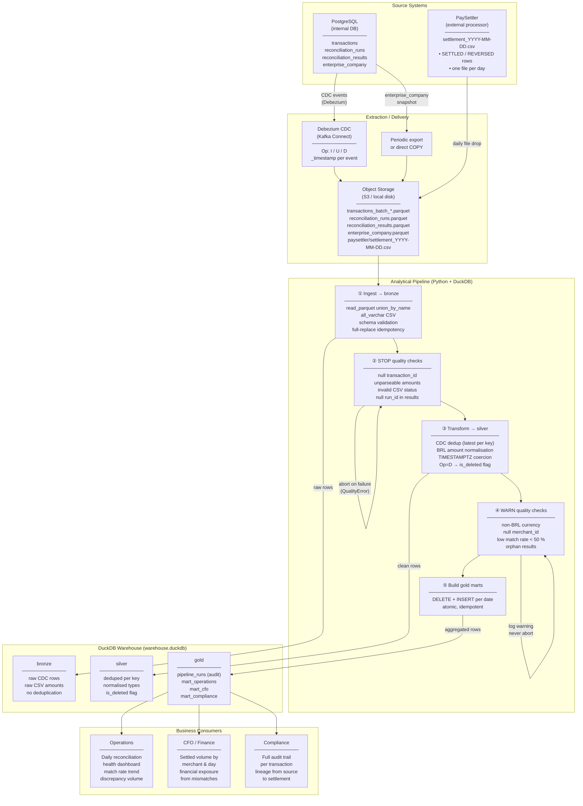
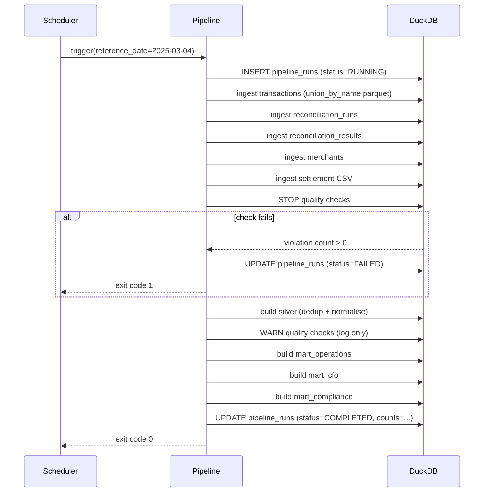

# Architecture Diagram — Settlement Reconciliation Analytics

## End-to-End Overview

---

## Layer Responsibilities

| Layer | Location | What it contains | Idempotency |
|-------|----------|-----------------|-------------|
| **bronze** | `bronze.*` tables | Raw CDC rows — every Op (I/U/D) preserved, amounts as VARCHAR, no deduplication | Full `DELETE + INSERT` per table |
| **silver** | `silver.*` tables | One row per business key (latest CDC state), normalised types, `is_deleted` flag | `DELETE WHERE reference_date = ?` then `INSERT` |
| **gold** | `gold.*` tables | Aggregated marts for each consumer, full lineage columns | `DELETE WHERE reference_date = ?` then `INSERT` |

---

## Pipeline Execution Sequence

---

## Key Design Decisions

| Decision | Choice | Rationale |
|----------|--------|-----------|
| Storage engine | Single DuckDB file | No external dependencies; ACID transactions; columnar scans are fast for analytical queries |
| Bronze amounts | `VARCHAR` | Preserves dirty source formats (`"R$ 23.696,77"`) for auditable normalisation in silver |
| CDC dedup | `ROW_NUMBER() OVER (PARTITION BY key ORDER BY _timestamp DESC)` | Handles both updates and replays deterministically |
| Idempotency | `DELETE WHERE date = ? + INSERT` | DuckDB 1.x lacks reliable `MERGE`; this pattern is atomic within a transaction |
| Schema drift | `read_parquet(..., union_by_name=True)` | `payment_method` was added in batch_2; `NULL` for older rows is semantically correct |
| STOP vs WARN | Two-tier quality gates | STOP protects data integrity (pipeline aborts); WARN signals business anomalies (pipeline continues) |
| Settlement lookup | Per-day file → consolidated fallback | Allows both generated (per-day) and sample-data (consolidated) layouts without code changes |
