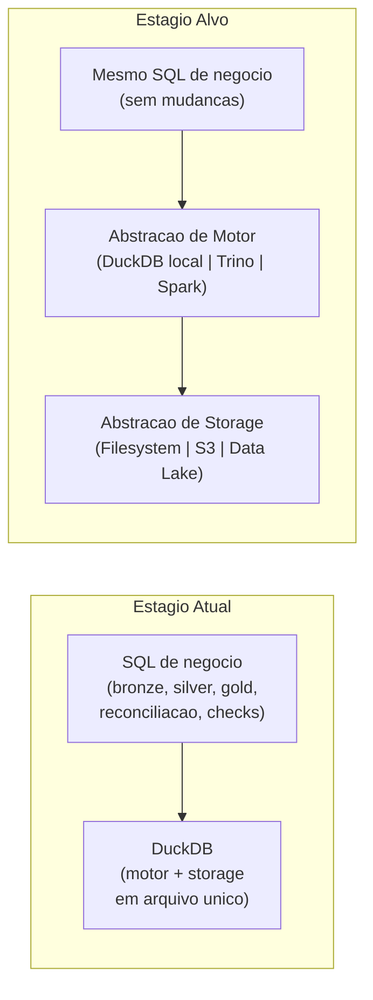

# Plano de Escalabilidade — Settlement Reconciliation Data Platform

## Contexto

O volume atual e pequeno (dados de exemplo com ~1.000 transacoes). A projecao de negocio e de **~5M transacoes/dia** em 18 meses, o que significa aproximadamente **150M transacoes/mes** e **1,8B linhas/ano** em `reconciliation_results`. Este documento identifica onde o design atual quebra primeiro e propoe caminhos de migracao incrementais.

---

## 1. Onde o Design Atual Quebra Primeiro (~5M transacoes/dia)

### 1.1 Arquivo DuckDB Unico (Gargalo Central)

O `warehouse.duckdb` e um arquivo monolitico no filesystem local. Neste modelo:

| Limite | Impacto estimado |
|---|---|
| **Memoria RAM**: DuckDB carrega dados em memoria para processamento. Com 5M transacoes/dia, so a tabela `reconciliation_results` tera ~5M linhas/dia * ~100 bytes/linha = ~500 MB/dia. Em 30 dias = ~15 GB so de resultados. O servidor precisaria de ~32-64 GB RAM para operacoes de join e agregacao confortavelmente. | Falha por OOM ou swapping agressivo |
| **I/O de disco**: DuckDB opera sobre um unico arquivo. Operacoes de escrita (DELETE+INSERT idempotente) requerem locks exclusivos. Com 5M linhas por run, o tempo de DELETE+INSERT cresce para minutos, e o arquivo cresce em fragmentacao sem `CHECKPOINT` frequente. | Tempo de execucao por run passa de segundos para dezenas de minutos |
| **Concorrencia**: DuckDB suporta um unico escritor. Se dois runs forem disparados para datas diferentes (backfill, re-processamento), um bloqueia o outro. | Impossibilidade de processamento paralelo |
| **Sem particionamento fisico**: A strategy atual de idempotencia (DELETE WHERE reference_date = X + INSERT) requer um scan completo da tabela para localizar as linhas do dia, cujo custo cresce linearmente com o volume historico. | Operacoes idempotentes ficam progressivamente mais lentas |

**Sintoma de quebra**: com ~150M linhas em `reconciliation_results`, um `DELETE WHERE reference_date = '2027-01-15'` pode levar minutos e gerar gigs de WAL temporario.

### 1.2 Ingestao de CSV em Memoria

O `csv_reader.py` carrega o CSV inteiro em memoria (`fetchall()`), aplica normalizacao linha a linha em Python puro, e re-insere em batches:

- CSV de 5M linhas * ~120 bytes/linha = ~600 MB em memoria raw
- A lista `rows_to_insert` duplica isso (Python objects sao ~3-5x maiores que o dado raw)
- Pico de uso de memoria: ~1.5-2 GB so para o CSV do dia

**Sintoma de quebra**: `MemoryError` ou OOM kill no container com limite de memoria padrao (Docker default: 1-2 GB).

### 1.3 Bronze com CREATE OR REPLACE

O bronze usa `CREATE OR REPLACE TABLE` para cada execucao, recriando todas as tabelas do zero. Com 5M transacoes/dia, isso significa:

- Re-leitura de todos os Parquet historicos a cada run
- Re-processamento de batches de CDC que acumulam bilhoes de eventos
- Nao ha particionamento por data -- nao e possivel ingerir apenas os dados novos

**Sintoma de quebra**: o tempo de ingestao do bronze cresce linearmente com o volume historico, nao com o delta diario.

### 1.4 Gold com CREATE OR REPLACE TABLE

As tabelas gold sao recriadas por completo a cada execucao. Isso implica:

- Re-computar agregacoes sobre toda a historia de `reconciliation_results` a cada run
- Com 1,8B linhas, a query de `gold.audit_discrepancies` escanea a tabela inteira
- O tempo da camada gold cresce linearmente com o historico

**Sintoma de quebra**: a camada gold demora mais que a silver/bronze juntas, tornando cada execucao diaria inviavel.

### 1.5 Inexistencia de Processamento Distribuido

O pipeline inteiro roda em um unico processo Python em um unico container. Nao ha:

- Sharding de dados por faixa de `merchant_id` ou `reference_date`
- Processamento paralelo de multiplos dias simultaneamente
- Capacidade de escalar horizontalmente adicionando workers

**Sintoma de quebra**: o tempo total por run ultrapassa a janela de processamento disponivel (ex.: run de 6h para o dia anterior, mas o SLA exige resultado em 2h).

---

## 2. Migracao de DuckDB Local para Solucao Distribuida (Sem Reescrever Logica de Negocio)

### 2.1 Principio: Abstracao de Storage

O refactoring-chave e introduzir uma camada de abstracao entre a logica de transformacao e o storage/motor de execucao. A logica de negocio permanece como SQL portavel; o que muda e onde o SQL executa e de onde os dados vem.



### 2.2 Roteiro de Migracao por Estagios

#### Estagio 1: DuckDB com particionamento em Parquet (sem mudanca de motor)

**Objetivo**: Resolver o problema de crescimento do arquivo `.duckdb` sem trocar de motor.

**Mudancas necessarias**:

1. Trocar `CREATE OR REPLACE TABLE` por `COPY TO ... PARTITION BY (reference_date)` no bronze e silver
2. DuckDB le Parquet particionado via `read_parquet('path/*/date=*/')` -- o motor DuckDB ja suporta isso nativamente
3. Manter apenas `control.pipeline_runs` e tabelas pequenas dentro do arquivo `.duckdb`; as tabelas grandes vivem como Parquet no filesystem

**Impacto no codigo**:

| Modulo | Mudanca | Linhas afetadas |
|---|---|---|
| `bronze.py` | Trocar `CREATE OR REPLACE TABLE` por `COPY TO` com particionamento | ~5 por funcao de load |
| `silver.py` | Trocar `CREATE OR REPLACE TABLE` por `INSERT INTO` com leitura de Parquet particionado | ~5 por funcao de build |
| `gold.py` | Trocar `CREATE OR REPLACE TABLE` por `COPY TO` Parquet | ~3 por funcao de build |
| `config.py` | Adicionar caminho base de storage particionado | ~5 |
| **Total** | | **~40-50 linhas** |

A logica SQL de transformacao (joins, deduplicacao, agregacoes, checks) permanece identica. Apenas a mecânica de leitura/escrita muda.

**Beneficio**: o tamanho do warehouse deixa de crescer linearmente; cada run so le/escreve os arquivos do dia relevante.

#### Estagio 2: Object Storage (S3/MinIO) como storage

**Objetivo**: Descoplar storage do servidor do pipeline.

**Mudancas**:
- Substituir caminhos locais (`/data/...`) por URIs de objeto (`s3://bucket/...`)
- DuckDB suporta `read_parquet('s3://...')` e `COPY TO 's3://...'` nativamente com a extensao `httpfs`
- Adicionar `con.execute("INSTALL httpfs; LOAD httpfs; SET s3_endpoint='...'; SET s3_access_key='...';")` na inicializacao

**Impacto no codigo**: ~10-15 linhas em `config.py` e no ponto de inicializacao da conexao DuckDB.

**Beneficio**: storage elástico e independente de instância; multiplos containers podem ler os mesmos Parquet.

#### Estagio 3: Multiplos Workers com DuckDB (mesmo motor, paralelismo)

**Objetivo**: Processar multiplos dias em paralelo sem mudar de motor.

**Mudancas**:
- Introduzir um dispatcher (simples script ou orquestrador) que chama `python -m pipeline.cli run --reference-date X` para N datas em paralelo
- Cada worker e um container Docker independente com seu proprio DuckDB
- Como o storage e Parquet no S3 (Estagio 2), multiplos workers podem ler os mesmos dados de entrada
- Cada worker escreve em seu proprio prefixo de saida: `s3://bucket/silver/reconciliation_results/date=2027-01-15/`

**Impacto na estrategia de idempotencia**: ver secao 4.

**Beneficio**: backfill de 30 dias que rodava em 30h agora roda em 1-2h com 15-20 workers paralelos.

#### Estagio 4: Motor Distribuido (Trino ou Spark) para queries de consumo

**Objetivo**: Suportar queries ad-hoc e dashboards sobre 1,8B linhas sem carregar tudo em memoria.

**Mudancas**:
- Os Parquet particionados no S3 (Estagio 2) sao o data lake
- Trino (ou Athena/Glue) aponta para o mesmo bucket e cataloga as tabelas
- Dashboards BI conectam ao Trino em vez do DuckDB
- O pipeline de escrita continua usando DuckDB (Estagio 2) porque e eficiente para ETL
- Apenas a camada de leitura (consumo) muda para o motor distribuido

**Impacto no codigo do pipeline**: **zero**. O pipeline continua escrevendo Parquet via DuckDB. Trino le os mesmos Parquet.

**Beneficio**: queries de consumo rodam em clusters distribuidos com escala linear; o pipeline de ETL permanece simples e local.

---

## 3. Estrategia de Particionamento para `reconciliation_results` (1,8B rows/ano)

### 3.1 Schema Proposto

```
s3://bucket/silver/reconciliation_results/
  reference_date=2027-01-15/
    part-0.parquet
    part-1.parquet
    ...
  reference_date=2027-01-16/
    part-0.parquet
    ...
```

**Chave primaria de particao**: `reference_date`

Justificativa:
- O pipeline ja opera por `reference_date` -- e o parametro de entrada da CLI e a chave de idempotencia
- Queries de consumo (gold) agrupam por `reference_date` em 100% dos casos
- Cada particao tem ~5M linhas (vivo), tamanho manejavel para um unico arquivo Parquet (~500 MB) ou multiplos arquivos menores (~50 MB cada)

### 3.2 Sub-particionamento (se necessario)

Se a granularidade diaria gerar particoes maiores que 1 GB em Parquet (acima de ~10M linhas/dia), adicionar sub-particionamento:

```
reference_date=2027-01-15/
  category=MATCHED/
    part-0.parquet
  category=MISMATCHED/
    part-0.parquet
  category=UNRECONCILED_PROCESSOR/
    part-0.parquet
  category=UNRECONCILED_INTERNAL/
    part-0.parquet
```

**Vantagem**: queries de consumos especificos (ex.: Compliance so quer MISMATCHED) leem apenas a particao relevante, pulando 90%+ dos dados.

### 3.3 Idempotencia com Particionamento

Com particionamento por `reference_date`, a estrategia de idempotencia muda de:

```sql
-- Atual (scan completo)
DELETE FROM silver.reconciliation_results WHERE reference_date = '2027-01-15';
INSERT INTO silver.reconciliation_results ...;
```

Para:

```sql
-- Com particionamento (drop + rewrite da particao)
-- Na pratica, com Parquet no S3:
-- 1. Escrever novos arquivos em staging: s3://bucket/_staging/reconciliation_results/date=2027-01-15/
-- 2. Validar (quality checks)
-- 3. Deletar particao antiga: s3://bucket/silver/reconciliation_results/reference_date=2027-01-15/
-- 4. Mover staging para producao: rename do prefixo
```

**Custo**: O(1) em relacao ao volume historico total. Depende apenas do volume do dia processado.

### 3.4 Compaction e Otimizacao

Apos multiplas escritas (re-runs, late data), uma particao diaria pode acumular muitos arquivos Parquet pequenos (o problema dos "small files"). Recomendacao:

- **Compaction automatica**: apos a escrita do dia, rodar um job leve que concatena os arquivos da particao em 1-3 arquivos Parquet otimizados (tamanho alvo: ~128-256 MB cada)
- **Frequencia**: diaria, como ultimo passo da run ou como job separado no orquestrador
- **Ferramenta**: DuckDB `COPY TO` ou `INSERT INTO` a partir dos arquivos pequenos, ou `duckdb` `COPY` com `FORMAT PARQUET`

### 3.5 Projection de Tamanho

| Metrica | Valor |
|---|---|
| Linhas/dia | 5.000.000 |
| Bytes/linha (estimativa) | ~100-120 bytes (Parquet comprimido) |
| Tamanho diário de `reconciliation_results` | ~500-600 MB |
| Tamanho mensal | ~15-18 GB |
| Tamanho anual | ~180-220 GB |
| Numero de arquivos Parquet/ano (1 arquivo/particao/dia) | ~365 |
| Numero de arquivos Parquet/ano (10 arquivos/particao/dia) | ~3.650 |

Esses numeros sao perfeitamente gerenciaveis com particionamento por data em object storage. O cenario de 1,8B linhas/ano cabe em um bucket S3 padrão sem nenhuma operacao exotica.

---

## 4. Idempotencia com Multiplos Workers Paralelos

### 4.1 O Problema

Na arquitetura atual, a idempotencia e garantida por:

1. Tabela `control.pipeline_runs` com status `IN_PROGRESS` / `COMPLETED` / `FAILED`
2. Bloqueio de runs duplicadas para a mesma `reference_date` (a menos que `--force`)
3. DELETE+INSERT em `silver.reconciliation_results` por `reference_date`

Com multiplos workers processando datas diferentes em paralelo, surgem novos cenarios:

| Cenario | Risco |
|---|---|
| Worker A processa 2027-01-15 enquanto Worker B processa 2027-01-16 | Sem conflito (datas diferentes), seguro |
| Worker A e Worker B ambos tentam processar 2027-01-15 | Concorrencia no `pipeline_runs` e nos dados de saida |
| Worker A falha no meio da escrita; Worker B inicia para a mesma data | Estado parcial/inconsistente |

### 4.2 Estrategia: Lock Distribuido por reference_date

**Abordagem recomendada**: lock distribuido (Redis, DynamoDB, ou database advisory lock) escopado por `reference_date`.

```
ACQUIRE_LOCK(reference_date='2027-01-15', owner='worker-A', ttl=3600)
  -> Sucesso: worker-A processa normalmente
  -> Falha: outro worker ja esta processando; abortar ou aguardar
```

### 4.3 Tabela de Controle Adaptada

Adicionar colunas na tabela `control.pipeline_runs`:

```sql
CREATE TABLE IF NOT EXISTS control.pipeline_runs (
    run_id          INTEGER PRIMARY KEY,
    reference_date  VARCHAR NOT NULL,
    status          VARCHAR NOT NULL DEFAULT 'IN_PROGRESS',
    started_at      TIMESTAMPTZ NOT NULL,
    completed_at    TIMESTAMPTZ,
    source_file_hash VARCHAR,
    worker_id       VARCHAR,           -- NOVO: identificador do worker
    lock_acquired_at TIMESTAMPTZ,      -- NOVO: momento do lock
    lock_ttl_seconds INTEGER DEFAULT 3600, -- NOVO: TTL do lock
    -- ... metricas existentes ...
    UNIQUE (reference_date, status)    -- NOVO: garante apenas uma run IN_PROGRESS por data
);
```

### 4.4 Protocolo de Execucao Paralela

Para cada worker que vai processar `reference_date = X`:

```
1. TENTAR ACQUIRIR LOCK:
   INSERT INTO control.pipeline_runs (run_id, reference_date, status, worker_id, ...)
   ON CONFLICT (reference_date, status) WHERE status = 'IN_PROGRESS'
   DO NOTHING
   -> Se inseriu: lock adquirido, prosseguir
   -> Se nao inseriu: outro worker ja esta processando, abortar

2. EXECUTAR PIPELINE (bronze -> silver -> gold)

3. EM CASO DE SUCESSO:
   UPDATE status = 'COMPLETED' WHERE run_id = X
   -> Lock liberado implicitamente

4. EM CASO DE FALHA:
   UPDATE status = 'FAILED' WHERE run_id = X
   -> Lock liberado implicitamente

5. EM CASO DE CRASH (worker morre sem atualizar status):
   Outro worker detecta run IN_PROGRESS ha mais de lock_ttl_seconds
   e assume o lock com novo run_id (equivalente ao --force atual)
```

### 4.5 Escrita Isolada por Worker

Com particionamento (secao 3), cada worker escreve em sua propria particao de data. Nao ha concorrencia nos dados de saida porque:

- Worker A escreve em `reference_date=2027-01-15/`
- Worker B escreve em `reference_date=2027-01-16/`
- Caminhos no storage sao completamente independentes

A unica superficie de concorrencia e a tabela `control.pipeline_runs` (resolvida pelo lock distribuido acima).

### 4.6 O Que Muda vs. O Que Permanece

| Aspecto | Estado Atual | Com Multiplos Workers |
|---|---|---|
| Contrato CLI | `run --reference-date X [--force]` | Inalterado -- cada worker invoca a mesma CLI |
| Logica de reconciliacao | SQL em `reconciliation.py` | Inalterado -- a query e por `reference_date` |
| Checks de qualidade | `checks.py` | Inalterado -- operam sobre os dados da run corrente |
| Idempotencia de dados | DELETE+INSERT por `reference_date` | Inalterado no efeito; muda para drop+rewrite de particao |
| Controle de runs | Unico escritor implicito | Lock explicito por `reference_date` |
| Flag `--force` | Override manual | Permanece para re-runs forcados pos-investigacao |

### 4.7 Cenario Especial: Late Data e Re-processamento

Se dados do dia 2027-01-15 chegarem atrasados (CDC lag, CSV reenviado pelo PaySettler), o re-processamento e seguro porque:

1. A particao `reference_date=2027-01-15/` e inteiramente substituida
2. O lock garante que apenas um worker por vez mexe naquela data
3. As tabelas gold que agregam multiplas datas sao re-computadas (ou incrementadas -- ver secao seguinte)

**Nota**: em producao com late data frequente, as tabelas gold devem adotar estrategia incremental: re-computar apenas as agregacoes das datas afetadas, nao a tabela inteira.
