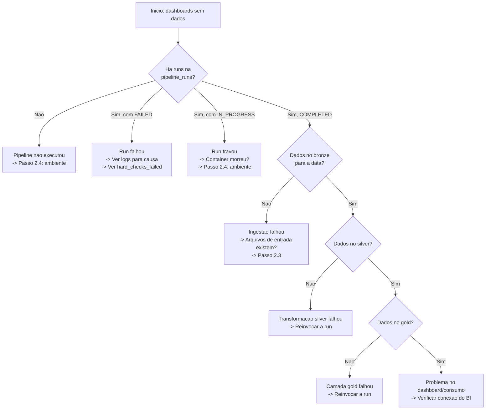

# Runbook: Incidente de Segunda-feira — Dashboards sem Dados desde Sexta-feira

## Cenario

Segunda-feira, 08:00. O time de Operacoes abre um chamado: os dashboards de reconciliacao estao sem dados desde sexta-feira a noite. Nenhuma atualizacao no fim de semana. Voce e o primeiro a chegar.

---

## Passo 1 — Verificar a Tabela de Controle (Primeiro Artefato)

A tabela `control.pipeline_runs` e o historico imutavel de todas as execucoes. Ela indica o que aconteceu (ou nao aconteceu) para cada data de referencia.

### Conectar ao container

```bash
docker compose exec pipeline bash
```

### Query de diagnostico: historico recente de runs

```sql
-- Conectar ao DuckDB
duckdb data/warehouse.duckdb

-- Ver as ultimas 10 runs ordenadas por data
SELECT
    run_id,
    reference_date,
    status,
    started_at,
    completed_at,
    total_processed,
    matched,
    mismatched,
    unreconciled_processor,
    unreconciled_internal,
    hard_checks_failed,
    soft_checks_failed,
    source_file_hash
FROM control.pipeline_runs
ORDER BY reference_date DESC, run_id DESC
LIMIT 10;
```

### Queries adicionais de diagnostico

```sql
-- Runs que falharam nos ultimos 7 dias
SELECT run_id, reference_date, status, started_at, completed_at
FROM control.pipeline_runs
WHERE status IN ('FAILED', 'IN_PROGRESS')
  AND started_at >= CURRENT_DATE - INTERVAL '7 days'
ORDER BY reference_date DESC;

-- Datas sem nenhuma run registrada (gap analysis)
WITH date_range AS (
    SELECT generate_series(
        (CURRENT_DATE - INTERVAL '7 days')::DATE,
        CURRENT_DATE::DATE,
        INTERVAL '1 day'
    )::DATE AS dt
),
run_dates AS (
    SELECT DISTINCT reference_date::DATE FROM control.pipeline_runs
          WHERE status = 'COMPLETED'
)
SELECT d.dt AS missing_date
FROM date_range d
LEFT JOIN run_dates r ON d.dt = r.reference_date
WHERE r.reference_date IS NULL
ORDER BY d.dt;

-- Runs em IN_PROGRESS ha mais de 1 hora (possivel zombie)
SELECT run_id, reference_date, started_at,
       EXTRACT(EPOCH FROM (NOW() - started_at)) / 3600.0 AS hours_elapsed
FROM control.pipeline_runs
WHERE status = 'IN_PROGRESS'
  AND started_at < NOW() - INTERVAL '1 hour';
```

### Interpretacao dos Resultados

| Situacao na `pipeline_runs` | Diagnostico | Proximo passo |
|---|---|---|
| Runs `COMPLETED` ate sexta-feira, nenhuma run para sabado e domingo | Pipeline nao foi executado no fim de semana (normal se nao ha agendamento) | Verificar se ha dados de sexta a noite que nao foram processados (Passo 3) |
| Run `IN_PROGRESS` para sexta-feira, nunca completou | Pipeline travou ou container morreu durante a execucao | Investigar logs do container (Passo 2) e forcar re-execucao (Passo 5) |
| Run `FAILED` para sexta com `hard_checks_failed` preenchido | Check de qualidade bloqueou o pipeline | Verificar qual check falhou, corrigir dado-fonte, re-executar (Passo 5) |
| Nenhuma run para sexta-feira sequer | Pipeline nao chegou a ser invocado | Verificar agendamento e saude do ambiente (Passo 2 e 3) |
| Runs `COMPLETED` mas com contagens zeradas | Ingestao trouxe dados vazios ou CSV ausente | Distinguir falha de ingestao vs. dado ausente (Passo 3) |

---

## Passo 2 — Diagnosticar: Falha de Pipeline vs. Falha de Ingestao vs. Dado Ausente

### 2.1 Verificar logs do container

```bash
# Logs gerais do container (ultimas 200 linhas)
docker compose logs --tail 200 pipeline

# Logs filtrando por erro
docker compose logs pipeline 2>&1 | grep -iE "(error|fail|exception|abort)"

# Logs da ultima execucao (se houver timestamp de referencia)
docker compose logs --since "2025-03-14T18:00:00" pipeline
```

**Sinais nos logs:**

| Padrao nos logs | Diagnostico |
|---|---|
| `"Pipeline failed"` + mensagem de erro | Falha de transformacao (silver/gold) ou check HARD |
| `"PaySettler CSV is empty"` | Ingestao: CSV presente porem vazio |
| `"HARD checks failed: [...]"` | Qualidade: check HARD rejeitou os dados |
| Nenhum log apos a ingestao do bronze | Falha na transicao bronze -> silver |
| Nenhum log de ingestao | Nem chegou a ler os dados de entrada |

### 2.2 Verificar dados na camada Bronze

```sql
-- Dentro do DuckDB:
-- Verificar se ha dados de bronze para a data problematica
SELECT
    'transactions_raw' AS tabela,
    count(*) AS rows,
    max(_reference_date) AS ref_date
FROM bronze.transactions_raw
UNION ALL
SELECT 'paysettler_raw', count(*), max(_reference_date) FROM bronze.paysettler_raw
UNION ALL
SELECT 'reconciliation_runs_raw', count(*), max(_reference_date) FROM bronze.reconciliation_runs_raw
UNION ALL
SELECT 'reconciliation_results_raw', count(*), max(_reference_date) FROM bronze.reconciliation_results_raw
UNION ALL
SELECT 'enterprise_company_raw', count(*), max(_reference_date) FROM bronze.enterprise_company_raw;

-- Se a tabela nao existir, e sinal de que a run nao completou nem o bronze
```

**Interpretacao:**

| Estado do Bronze | Diagnostico |
|---|---|
| Tabelas bronze existem com dados | Ingestao OK, problema na silver/gold |
| Tabelas bronze nao existem | Pipeline falhou antes da ingestao ou nem executou |
| Tabela bronze existe mas com zero linhas | Arquivos de entrada estavam vazios ou ausentes |

### 2.3 Verificar arquivos de entrada (dados da fonte)

```bash
# Verificar se os arquivos Parquet e CSV existem e tem conteudo
ls -lh docs/sample-data/transactions_batch_1.parquet
ls -lh docs/sample-data/transactions_batch_2.parquet
ls -lh docs/sample-data/reconciliation_runs.parquet
ls -lh docs/sample-data/reconciliation_results.parquet
ls -lh docs/sample-data/enterprise_company.parquet
ls -lh docs/sample-data/settlement_paysettler.csv

# Em producao, verificar o bucket/SFTP:
# aws s3 ls s3://bucket/paysettler/2025-03-14/
# ou: ls /data/input/paysettler/2025-03-14/
```

**Verificar conteudo do CSV do PaySettler:**

```bash
# Contar linhas do CSV (deve ter > 0 linhas de dados alem do header)
wc -l docs/sample-data/settlement_paysettler.csv

# Ver as primeiras linhas para confirmar que nao esta corrompido
head -5 docs/sample-data/settlement_paysettler.csv
```

**Fluxo de decisao:**



### 2.4 Distinguir ingestao vs. fonte ausente

Se a ingestao trouxe zero linhas, e necessario determinar se o pipeline falhou ao ler ou se os dados nao existiam:

| Verificacao | Comando | Interpretacao |
|---|---|---|
| Arquivo Parquet existe e tem conteudo | `ls -lh docs/sample-data/transactions_batch_1.parquet` | Se existe com tamanho > 0, a fonte esta OK. Problema e de leitura no pipeline. |
| Arquivo CSV existe e tem conteudo | `wc -l docs/sample-data/settlement_paysettler.csv` | Se tem apenas 1 linha (header), o PaySettler enviou arquivo vazio. Problema e do fornecedor. |
| Arquivo CSV nao existe | `ls docs/sample-data/settlement_paysettler.csv` | Se o arquivo nao existe, o PaySettler nao enviou o arquivo. Problema e do fornecedor. |
| Arquivo Parquet corrompido | `python -c "import duckdb; duckdb.query(\"SELECT count(*) FROM read_parquet('docs/sample-data/transactions_batch_1.parquet')\")"` | Se falhar, o arquivo esta corrompido. Problema e de export do PostgreSQL/CDC. |

---

## Passo 3 — Checks de Saude do Ambiente Docker

### 3.1 Verificar se o container esta rodando

```bash
# Status dos servicos
docker compose ps

# Se o container nao esta rodando:
docker compose up -d
```

**Sinais de problema:**

| Saida de `docker compose ps` | Diagnostico |
|---|---|
| Container com status `Up` | Container saudavel; problema esta no pipeline ou nos dados |
| Container com status `Exited (1)` | Pipeline falhou e o container encerrou. Ver `docker compose logs pipeline` |
| Container nao listado | Container foi removido ou nunca foi iniciado. Rodar `docker compose up -d` |
| Container reiniciando (`Restarting`) | Loop de crash. Ver logs para causa raiz |

### 3.2 Verificar recursos do container

```bash
# Uso de CPU e memoria
docker stats --no-stream pipeline

# Verificar limites de memoria (se definidos)
docker inspect pipeline --format '{{.HostConfig.Memory}}'

# Espaco em disco dentro do container
docker compose exec pipeline df -h /app

# Espaco em disco no host (para o volume montado)
df -h /home/tiago/Desktop/github/data-engineer-challenge/data/
```

**Sinais de problema:**

| Metrica | Valor critico | Diagnostico |
|---|---|---|
| Memoria usada | > 90% do limite alocado | Risco de OOM kill; aumentar limite ou reduzir volume por run |
| Disco no `/app` | > 90% | Warehouse DuckDB cresceu demais; limpar com `CHECKPOINT` + `DELETE OLD FILES` |
| Disco no host | > 90% | Volume de dados esta enchendo; necessario rotacao de arquivos ou expansao |

### 3.3 Verificar conectividade dos volumes

```bash
# Dentro do container, verificar se os volumes estao montados corretamente
docker compose exec pipeline ls -la /app/docs/sample-data/
docker compose exec pipeline ls -la /app/scripts/
docker compose exec pipeline ls -la /app/tests/

# Verificar se o warehouse DuckDB esta acessivel
docker compose exec pipeline python -c "
import duckdb
con = duckdb.connect('/app/data/warehouse.duckdb')
tables = con.execute('SHOW ALL TABLES').fetchall()
for t in tables:
    print(t)
con.close()
"
```

**Sinais de problema:**

| Sintoma | Diagnostico |
|---|---|
| `/app/docs/sample-data/` vazio | Volume nao montado ou montagem read-only falhou |
| Erro ao abrir warehouse DuckDB | Arquivo corrompido ou permissao insuficiente |
| `SHOW ALL TABLES` retorna zero tabelas | Warehouse foi deletado ou pipeline nunca executou com sucesso |

### 3.4 Verificar integridade do warehouse DuckDB

```bash
docker compose exec pipeline python -c "
import duckdb
con = duckdb.connect('/app/data/warehouse.duckdb')

# Listar schemas e tabelas com contagens
schemas = con.execute(\"SELECT schema_name FROM information_schema.schemata WHERE schema_name NOT IN ('main', 'information_schema', 'pg_catalog')\").fetchall()
for s in schemas:
    print(f'Schema: {s[0]}')
    tables = con.execute(f\"SELECT table_name FROM information_schema.tables WHERE table_schema = '{s[0]}'\").fetchall()
    for t in tables:
        cnt = con.execute(f\"SELECT count(*) FROM {s[0]}.{t[0]}\").fetchone()[0]
        print(f'  {s[0]}.{t[0]}: {cnt} rows')

# Checkpoint para limpar WAL temporario
con.execute('CHECKPOINT')
con.close()
print('Warehouse OK, checkpoint executado')
"
```

---

## Passo 4 — Escalacao: Quando e Como Acionar Cada Time

### 4.1 Matriz de Escalacao

| Cenario | Time Responsavel | Quando Escalar | Como |
|---|---|---|---|
| Pipeline falhou por check HARD (dado invalido) | **Time de Dados** | Apos confirmar que o dado de entrada esta corrompido e nao e problema de codigo | Slack #data-platform com print da query em `pipeline_runs` e log do erro |
| CSV do PaySettler vazio, ausente ou corrompido | **PaySettler (fornecedor)** | Apos confirmar que o arquivo deveria existir (dia util) e nao esta no bucket/SFTP | Email para o contato tecnico do PaySettler + abrir ticket no portal deles |
| Export CDC do PostgreSQL falhou ou esta desatualizado | **Engenharia (backend)** | Apos confirmar que os Parquet de entrada nao estao sendo gerados ou estao incompletos | Slack #engineering-infra com evidencia (timestamp do ultimo export, tamanho do arquivo) |
| Container Docker morreu ou esta em loop de crash | **Time de Dados** (auto-servico) | Apos tentar reiniciar 1 vez sem sucesso | Se persistir, escalar para #engineering-infra |
| Dashboards funcionam mas dados estao incorretos | **Time de Dados** | Imediato — dado incorreto e pior que dado ausente | Slack #data-platform com query que demonstra a inconsistencia |
| Warehouse DuckDB corrompido | **Time de Dados** | Apos confirmar que `CHECKPOINT` + reabertura nao resolve | Recriar warehouse do zero (re-execucao full) |

### 4.2 Escalacao Simultanea (Paralela)

Se o incidente afeta mais de um sistema e a causa raiz nao e clara, escale em paralelo:

1. **Time de Dados** (voce): investiga logs, pipeline_runs, estado do warehouse
2. **Engenharia**: verifica se o PostgreSQL esta saudavel e o CDC esta fluindo
3. **PaySettler**: confirma se houve falha no envio do CSV diario

### 4.3 Comunicacao Durante o Incidente

Template de mensagem para o canal de incidentes:

```
[INCIDENTE] Dashboards de reconciliacao sem dados desde DD/MM
Status: Em investigacao
Impacto: Dashboards de Operacoes, CFO e Compliance sem atualizacao
Sintoma: [descrever o que foi encontrado no pipeline_runs]
Acao corrente: [o que esta fazendo agora]
Proxima atualizacao: [horario]
Responsavel: [seu nome]
```

---

## Passo 5 — Procedimento de Re-execucao Segura para Datas Perdidas

### 5.1 Prerequisitos antes de re-executar

Antes de iniciar a re-execucao, verifique:

1. **Causa raiz foi eliminada**: se o CSV estava vazio, o PaySettler reenviou? Se o container estava sem memoria, o limite foi aumentado?
2. **Nenhuma run IN_PROGRESS**: verificar se nao ha runs zombies:

```sql
SELECT run_id, reference_date, started_at,
       EXTRACT(EPOCH FROM (NOW() - started_at)) / 3600.0 AS hours_elapsed
FROM control.pipeline_runs
WHERE status = 'IN_PROGRESS';
```

3. **Espaco em disco suficiente**: a re-execucao recria as camadas bronze/silver/gold:

```bash
df -h /app/data/
```

### 5.2 Re-execucao para uma unica data

```bash
# Dentro do container:
docker compose exec pipeline bash

# Verificar status atual antes de re-executar
python -m pipeline.cli status --reference-date 2025-03-14

# Re-executar com --force (necessario se ha run IN_PROGRESS ou COMPLETED)
python -m pipeline.cli run --reference-date 2025-03-14 --force

# Verificar resultado
python -m pipeline.cli status --reference-date 2025-03-14
```

**A flag `--force` e necessaria quando:**
- Existe uma run `IN_PROGRESS` para a mesma data (zombie ou em andamento)
- Existe uma run `COMPLETED` e voce deseja re-processar (ex.: dado fonte atualizado)

**A idempotencia garante que:**
- Registros em `silver.reconciliation_results` para a data sao removidos (DELETE) antes de re-inserir
- As tabelas gold sao recriadas por completo (CREATE OR REPLACE)
- A tabela `control.pipeline_runs` recebe um novo `run_id` (nunca sobrescreve o historico)

### 5.3 Re-execucao para multiplas datas (backfill)

Para datas consecutivas que nao foram processadas (ex.: sexta-feira a noite + sabado + domingo):

```bash
# Dentro do container, executar para cada data perdida
for date in 2025-03-14 2025-03-15 2025-03-16; do
    echo "=== Re-executando para $date ==="
    python -m pipeline.cli run --reference-date "$date" --force
    exit_code=$?
    if [ $exit_code -ne 0 ]; then
        echo "FALHA em $date (exit code: $exit_code). Abortando backfill."
        break
    fi
    echo "Sucesso para $date"
    python -m pipeline.cli status --reference-date "$date"
    echo ""
done
```

**Importante**:
- Executar datas em ordem cronologica
- Se uma data falhar, **nao pular para a proxima**. Investigar a causa antes de prosseguir.
- Cada execucao e independente (idempotente por data), mas a camada gold e recriada por completo a cada run, entao a ultima run determina o estado final do gold.

### 5.4 Re-execucao com dados de entrada atualizados

Se o PaySettler reenviou o CSV ou o CDC trouxe novos eventos, os dados de entrada mudaram. A re-execucao e segura porque:

1. O `source_file_hash` na tabela `pipeline_runs` sera diferente (detectavel)
2. O bronze re-le os arquivos de entrada (CREATE OR REPLACE)
3. O silver re-processa os dados do zero
4. A reconciliacao usa DELETE+INSERT por `reference_date`
5. O gold e completamente recriado

```bash
# Apos confirmar que os novos dados de entrada estao no lugar:
docker compose exec pipeline python -m pipeline.cli run --reference-date 2025-03-14 --force
```

### 5.5 Verificacao pos-re-execucao

Apos a re-execucao, valide que os dados estao corretos:

```sql
-- Conectar ao DuckDB
duckdb data/warehouse.duckdb

-- 1. Verificar que a run completou com sucesso
SELECT run_id, status, total_processed, matched, mismatched
FROM control.pipeline_runs
WHERE reference_date = '2025-03-14'
ORDER BY run_id DESC LIMIT 1;
-- Esperado: status = 'COMPLETED'

-- 2. Verificar contagens na silver
SELECT category, count(*) AS cnt
FROM silver.reconciliation_results
WHERE reference_date = '2025-03-14'
GROUP BY category;
-- Esperado: MATCHED >> MISMATCHED para um dia saudavel

-- 3. Verificar que as tabelas gold tem dados
SELECT count(*) FROM gold.daily_reconciliation_health
WHERE reference_date = '2025-03-14';
-- Esperado: 1 linha

SELECT count(*) FROM gold.daily_financial_volume
WHERE reference_date = '2025-03-14';
-- Esperado: 1 linha

-- 4. Verificar taxa de discrepancia (SOFT check)
SELECT discrepancy_rate
FROM gold.daily_reconciliation_health
WHERE reference_date = '2025-03-14';
-- Esperado: < 0.20 (20%)
```

---

## Checklist de Resolucao Rapida

Resumo em ordem de execucao para resolver o incidente o mais rapido possivel:

1. [ ] **Conectar ao container**: `docker compose exec pipeline bash`
2. [ ] **Verificar `pipeline_runs`**: rodar a query de historico recente e identificar o estado da ultima run
3. [ ] **Verificar logs**: `docker compose logs --tail 200 pipeline`
4. [ ] **Classificar a causa**:
   - Pipeline nao executou -> verificar agendamento e container
   - Run FAILED -> verificar `hard_checks_failed` e logs
   - Run IN_PROGRESS (zombie) -> usar `--force`
   - Dados da fonte ausentes -> acionar fornecedor (PaySettler) ou Engenharia (CDC)
5. [ ] **Verificar saude do Docker**: `docker compose ps`, `docker stats`, `df -h`
6. [ ] **Escalar se necessario**: seguir a matriz de escalacao (Passo 4)
7. [ ] **Re-executar para datas perdidas**: `python -m pipeline.cli run --reference-date YYYY-MM-DD --force`
8. [ ] **Validar pos-re-execucao**: rodar queries de verificacao no DuckDB
9. [ ] **Comunicar resolucao**: atualizar canal de incidentes com resultado

---

## Tempos Estimados de Resolucao

| Cenario | Tempo ate Diagnostico | Tempo ate Resolucao |
|---|---|---|
| Run travou (zombie) | 5-10 min (query pipeline_runs) | 10-15 min (--force re-run) |
| Pipeline nao executou (sem agendamento) | 10-15 min | 15-20 min (executar manual) |
| CSV do PaySettler ausente | 5-10 min | Variavel (depende do fornecedor) |
| CDC do PostgreSQL desatualizado | 15-20 min | Variavel (depende da Engenharia) |
| Container sem memoria/disco | 10-15 min | 20-30 min (limpar, reconfigurar, re-run) |
| Warehouse DuckDB corrompido | 15-20 min | 30-60 min (recriar do zero com backfill) |
